# 🔒 Szept — Peer-to-Peer Encrypted Messenger

> **No servers. No phone numbers. No metadata leaks.**
>
> *Szept* (Polish for *whisper*) is a peer-to-peer, end-to-end encrypted messenger written in Go.
> Available as a terminal client (**TUI**), a desktop GUI (**Linux / Windows**), and a mobile app (**Android**).

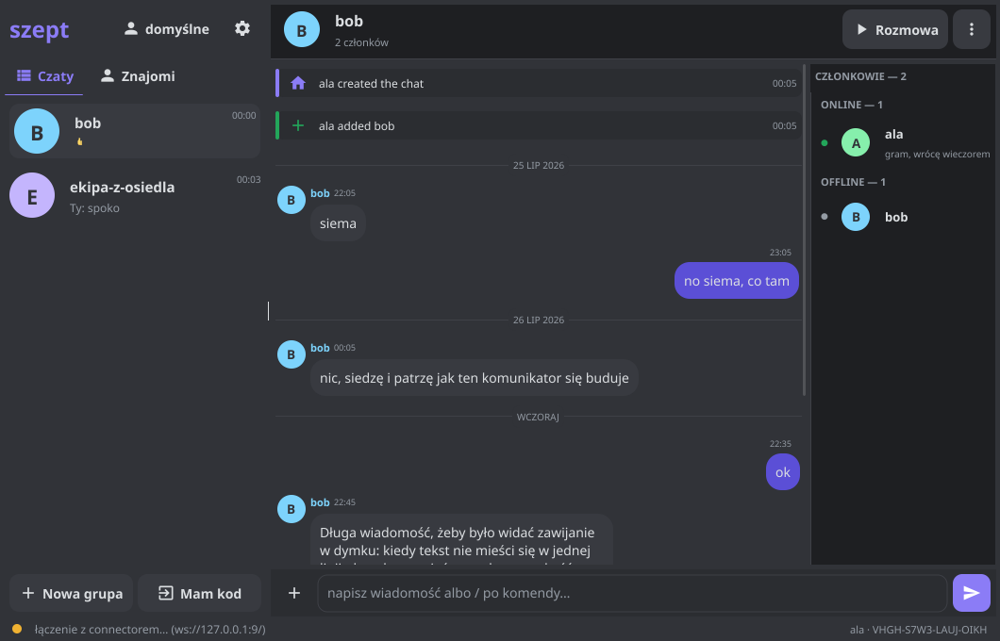

---

## ✨ Features

| Category | What you get |
|---|---|
| **Encryption** | Ed25519 identity · XChaCha20-Poly1305 epoch keys · DTLS 1.2+ transport |
| **P2P & Serverless** | Content never touches a server. Peers exchange data directly over WebRTC. |
| **Cebulion Network** | Optional authenticated mesh of connectors with SNDP gossip discovery and automatic failover — if any connector goes down, the network keeps running. |
| **DPI-Proof Obfuscation** | Every peer-to-peer UDP datagram is wrapped in a ChaCha20 keystream with variable random padding — STUN/DTLS headers vanish, leaving only high-entropy noise. |
| **DAG History** | Every chat is a signed, SHA-256 hash-linked DAG with Lamport-ordered events. History syncs automatically when peers reconnect. |
| **Voice, Video & Screen** | Real-time mesh calls with camera and desktop sharing (up to ~8 peers), an in-call control panel, per-person volume, deafen, and a **spatial room** where position drives the mix (3D on Android, top-down on the desktop). |
| **Profiles** | Avatar, animated banner, status line and description — one signed event, framed in-app before it is sent. |
| **File Attachments** | Inline previews for images, GIFs, video. Large files (>10 MB) replicate a thumbnail first; full payload pulled on demand in 16 KB chunks. |
| **Multiple Accounts** | Several identities on one device, each with its own database — switch from the unlock screen. Backup and restore as a zip. |
| **Bots** | A local, token-guarded webhook: any script on your machine can post a message that Szept signs and encrypts as if you typed it. |
| **Modern Chat UX** | Member column with presence · typing indicators · delivery & read receipts (`✓` / `✓✓`) · emoji reactions · full-text search · global & local message deletion |

---

## 📸 Screenshots

| Conversation with member column | In-call control panel |
|---|---|
|  | 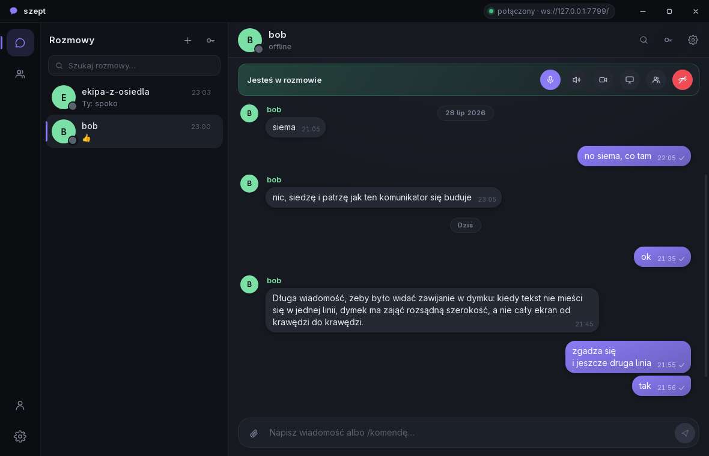 |

| Profile card | Framing a banner |
|---|---|
| 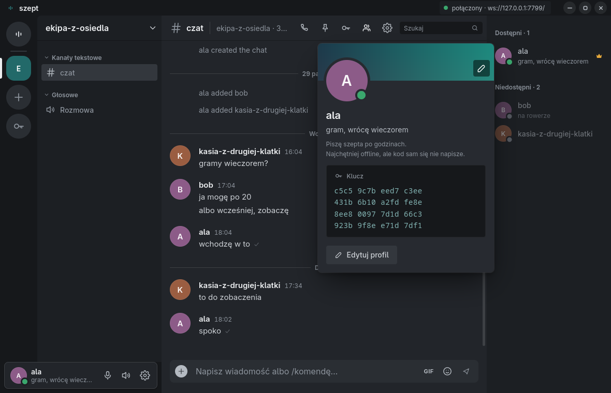 | 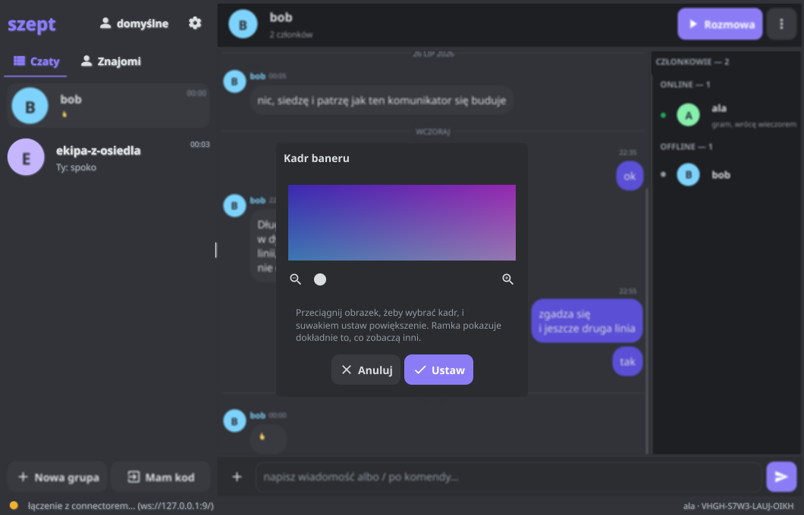 |

| Settings — accounts | Settings — bots / webhooks |
|---|---|
| 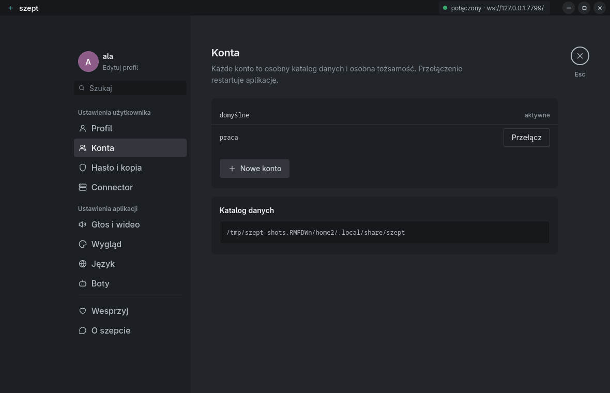 | 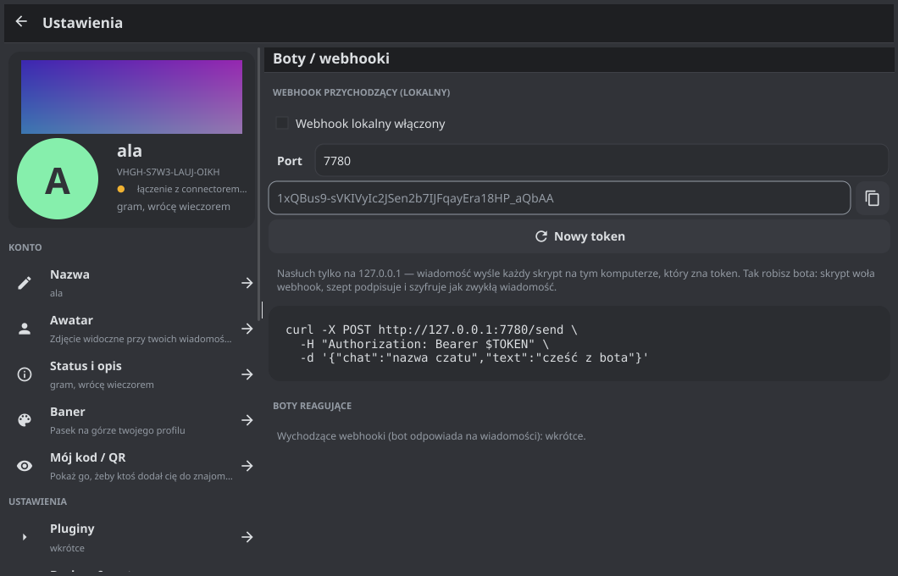 |

| 3D voice scene (Android) | Scene, person selected |
|---|---|
| 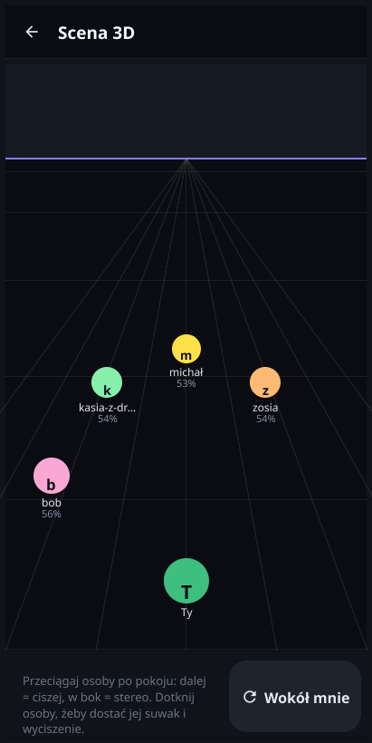 | 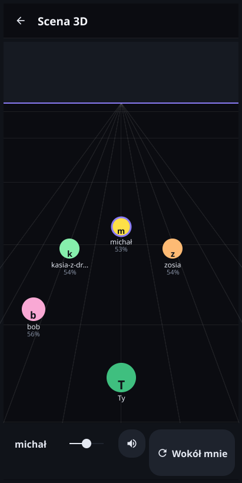 |

Mobile (same code, different shell):

| Chats | Conversation | Friends | Call |
|---|---|---|---|
| 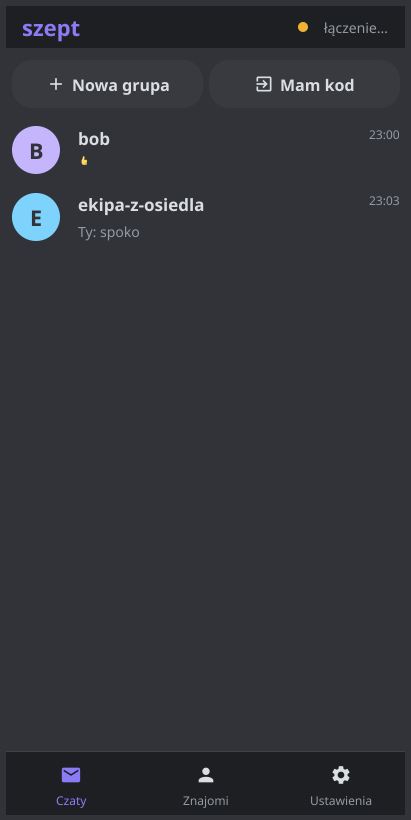 | 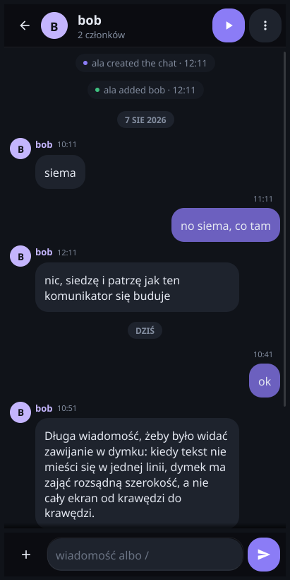 | 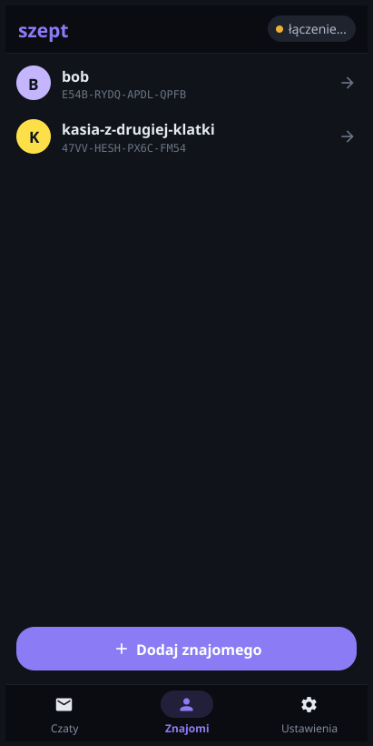 | 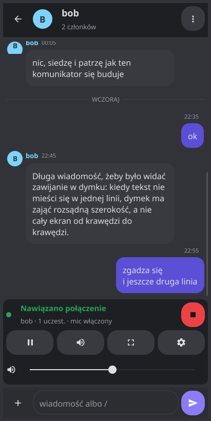 |

> These are generated from the app itself, not mockups — see [Development](#-development).

---

## 🏗️ Architecture & Connection Flow

Szept requires **no central application server**. The only infrastructure is a lightweight **Connector** — a ~200-line stateless relay (like a torrent tracker). It maps `pubkey → socket` and relays signed signaling blobs. It **never** sees message content, keys, or membership.

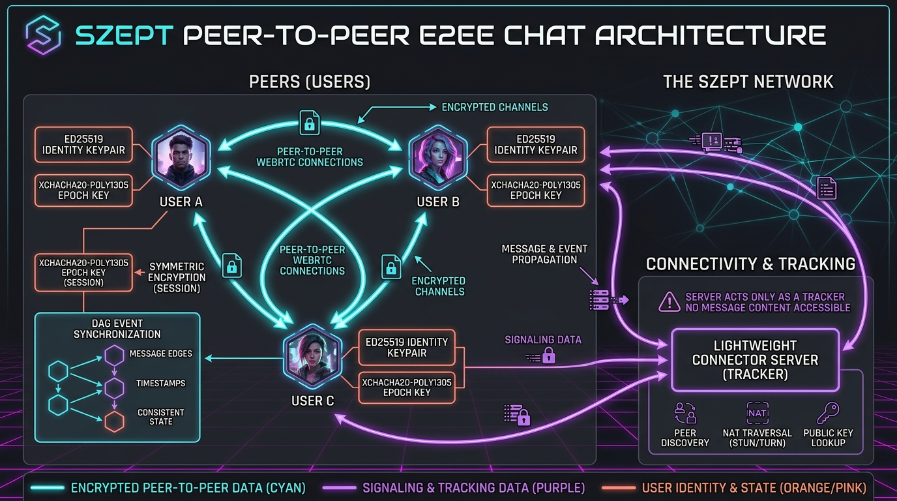

**Connection lifecycle:**
1. **Register** — Client sends Ed25519-signed timestamp; connector maps pubkey to WebSocket.
2. **Signal** — SDP offer (containing DTLS cert fingerprint + 32-byte obfuscation key) is Ed25519-signed, sealed to the addressee (ephemeral X25519 + XChaCha20-Poly1305) and relayed; the connector cannot read it. ±2 min freshness window, explicit addressee, glare tie-break (lower pubkey wins).
3. **Connect** — DTLS 1.2+ handshake directly between peers. Certificate is identity-bound — connector cannot MITM.
4. **Sync** — Peers exchange DAG head hashes and pull missing events over the authenticated E2E channel.

**Does the connector have to stay up?** Only while a link is being established. Once the DTLS channel exists, messages, files and calls go straight between peers — the connector can die and the conversation continues. It is needed for every *new* link and for every reconnect after one drops (sleep, network change, NAT rebind), because there is no fallback rendezvous: ICE mDNS is disabled and there is no direct-IP dial. Writing while disconnected still works — events land in your local DAG and travel over `sync` once the link is back, though delivery needs both sides online at the same time (no store-and-forward mailbox). Recovery is automatic: the client reconnects with backoff and re-dials known peers every 30 s. Details in [SECURITY.md](SECURITY.md#when-the-connector-is-needed).

---

## 🧅 Cebulion Network — Resilient Connector Mesh

A single connector works fine, but connectors can also join the **Cebulion Network** — a distributed mesh that provides fault tolerance. If any connector goes down or gets blocked, the rest of the network keeps routing signals.

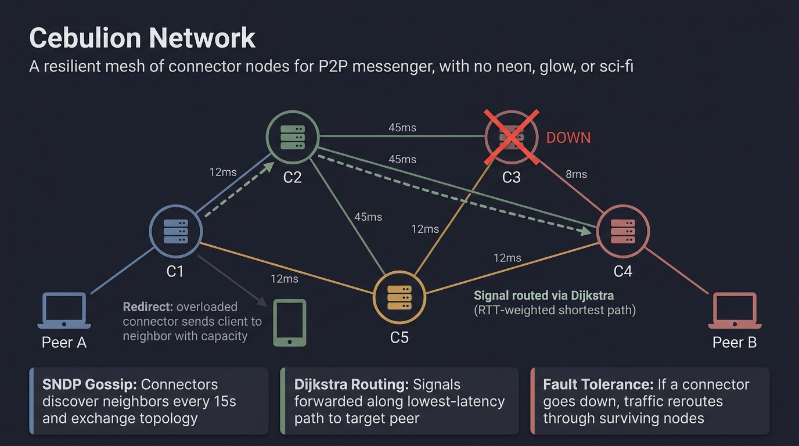

### How it works

| Component | Mechanism |
|---|---|
| **Open mesh** | Anyone can run a connector and join with `--seeds`. There is no shared password, because in a volunteer network the censor would have it too. A hostile node is contained: payloads are end-to-end signed, every mesh socket is rate limited, and floods take several paths. `--mesh-secret` makes a private mesh of trusted nodes; `--mesh=false` keeps a connector standalone. `--private-gossip` hides a node from anyone walking the mesh: it shares no neighbours (except with `--mesh-secret` peers), sends no redirect lists, and asks its neighbours not to pass its address on. It still joins through `--seeds` and relays as usual. |
| **Gossip** | Every 15 seconds each connector asks its seeds and neighbours for gossip over the same WebSocket. A reply holds at most 8 URLs, picked per asking /16 network, so nobody gets the full node list from one place. A gossiped URL is only a candidate until it answers our own dial. Neighbour URLs must be public `ws://`/`wss://` addresses, checked again after DNS resolution. |
| **Lookup** | When a client asks about a key the connector does not host, the connector asks the mesh (`mesh_lookup`). The connector that hosts the key answers `mesh_found`, and every node on the way back remembers which neighbour leads to that key. Clients on different connectors can find each other. |
| **Relaying** | A `mesh_signal` goes to the neighbour remembered for its key, plus up to 4 other neighbours, so one lying node cannot swallow it. Max 64 neighbours per connector, 64 queued frames per neighbour. |
| **Loop prevention** | Each mesh frame carries a random `TraceID` and a `TTL` (5). Seen traces live in a ring of 20 000; a flood pushes out old entries and can no longer stop relaying. |
| **Load balancing** | When `--max-peers` is reached, the connector sends a `redirect` with 3 neighbour URLs and closes. The client reconnects to a neighbour automatically. |
| **Fallback URLs** | Clients maintain a list of `FallbackURLs` (populated from redirects and invite codes); on disconnect, they try each URL before backing off. A redirect may not downgrade `wss://` to `ws://`, and the list is capped at 8. |
| **DNS resilience** | If system DNS fails (`no such host`), the client falls back to resolving via `1.1.1.1:53`, and if port 53 is blocked, via DNS-over-HTTPS (DoH) to `1.1.1.1`. |

**Hiding a connector from censors.** A connector only answers on a secret path (random by default, kept in `connector.path`, printed at start). Every other request gets a plain 404, or with `--decoy https://some-site` that site's pages. There is no status page. With `--domain` it serves `wss://` on 443 with an automatic Let's Encrypt certificate, so to an observer it is an ordinary HTTPS website.

**Relay (TURN) and hiding your IP.** A connector with a known public address (`--domain`, `--public-url` or `--turn <IP>`) also runs STUN and TURN on UDP at its listen port. Clients then use the connector instead of Google's STUN, and peers behind carrier-grade NAT still connect through the relay. With **Settings → Connector → "Hide my IP address"** (`relay_only` in `config.json`) every connection goes through the relay only, so your contacts see the connector's address, never yours. The connector operator then sees who you talk to, when and how much (never the content), so the app asks for explicit consent and tells the other person that the link is relayed. `--turn off` disables the relay; `--turn-rate` caps its bandwidth for all users together (KB/s each way, default 2048, `0` = no cap).

**History for new members.** A new group hides earlier messages from people added later: they get keys only from the moment they join, and the owner rotates the key after every add automatically. Tick "New members see earlier history" when creating the group to turn that off. A newcomer can read and write once the owner's client has rotated the key.

**Hiding your contact list.** By default the app asks the connector every 30 s whether each contact is online, so the connector learns your whole contact list. **Settings → Connector → "Hide my contact list from the connector"** (`quiet_lookup`) asks only about people in chats you opened or used in the last 15 minutes. Presence dots for everyone else go stale.

**Starting a connector in the mesh:**
```bash
./bin/szept-connector --domain c1.example.com \
  --seeds wss://c2.example.com/9f2c…,wss://c3.example.com/41ab… \
  --decoy https://example.org
# clients and other nodes use the URL it prints: wss://c1.example.com/<secret path>
```

### Switching connectors from the app

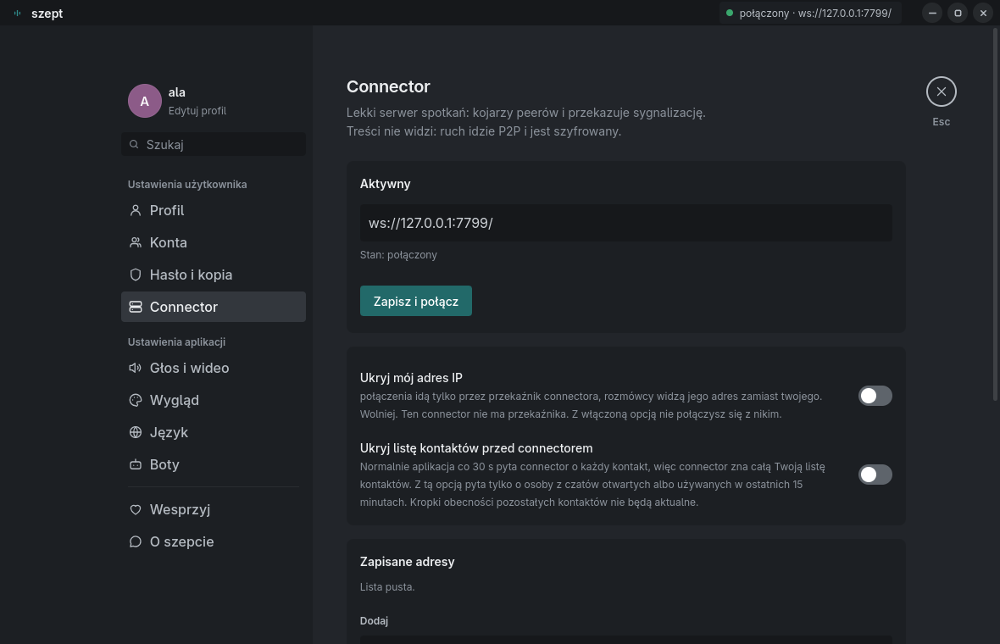

Settings → **Connectory** keeps a saved list of connectors to switch between, plus optional **dynamic lists**: an `https://` address returning one `ws://` URL per line. A refresh appends new entries to your saved list — it never connects you anywhere by itself. Guards: `https://` only, no redirects, 64 KB per list, 8 s timeout, `ws://` / `wss://` lines only. See [SECURITY.md](SECURITY.md#switching-connectors-and-dynamic-connector-lists) for what a list host does and does not learn.

---

## 🔒 DPI-Proof Traffic Obfuscation

Under strict firewalls or deep packet inspection, Szept wraps all peer-to-peer UDP datagrams in a **ChaCha20 obfuscation layer**.

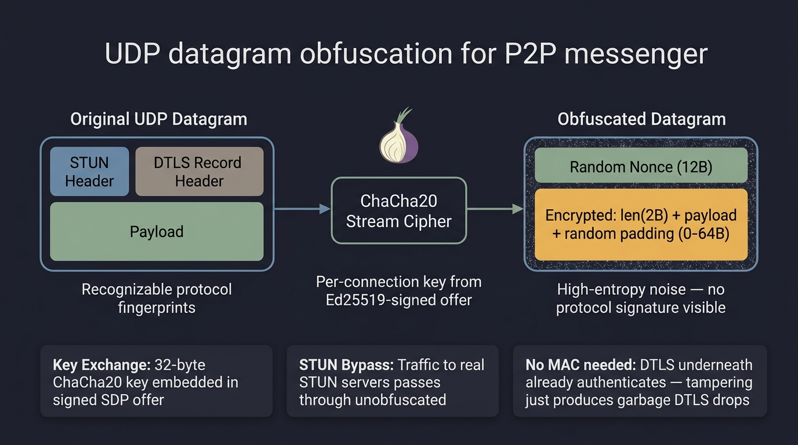

- **Per-connection key** — the offerer generates a 32-byte ChaCha20 key and embeds it in the Ed25519-signed SDP offer (`sigPayload.Obf`). The offer is sealed to the addressee, so only that peer (not the connector) can derive the keystream.
- **Wire format** — `nonce(12B) || ChaCha20(len(2B) || plaintext || random_padding(0–64B))`. No MAC — DTLS underneath already authenticates, so a tampered datagram decrypts to garbage that DTLS drops.
- **STUN bypass** — traffic to public STUN servers (discovered via `ResolveUDPAddr`) passes through unobfuscated so ICE server-reflexive candidates still work.
- **mDNS disabled** — prevents `.local` multicast from leaking cleartext alongside the obfuscated flow.

**Result**: on the wire, traffic is indistinguishable from random noise — DPI cannot fingerprint WebRTC, STUN, or DTLS protocols.

---

## 🪪 Identity, Friends & the Profile Card

### Your code carries a key, not a name

A friend code is `{public key, connector hint}` — **nothing else**. Codes end up in screenshots, photographed QR codes and clipboards, so they carry only what is needed to reach you. Your display name arrives later, over the already-encrypted link, and only for people who already have you on their list.

Because names are announced rather than proven, Szept keeps the receipts: every name a person has used lives in the signed DAG (`nick` events), and the profile screen lists them oldest-first. Someone renaming themselves to impersonate a friend leaves a trail everybody in the chat can read. The fingerprint (`VHGH-S7W3-LAUJ-OIKH`) is the thing worth comparing out of band.

### The profile card

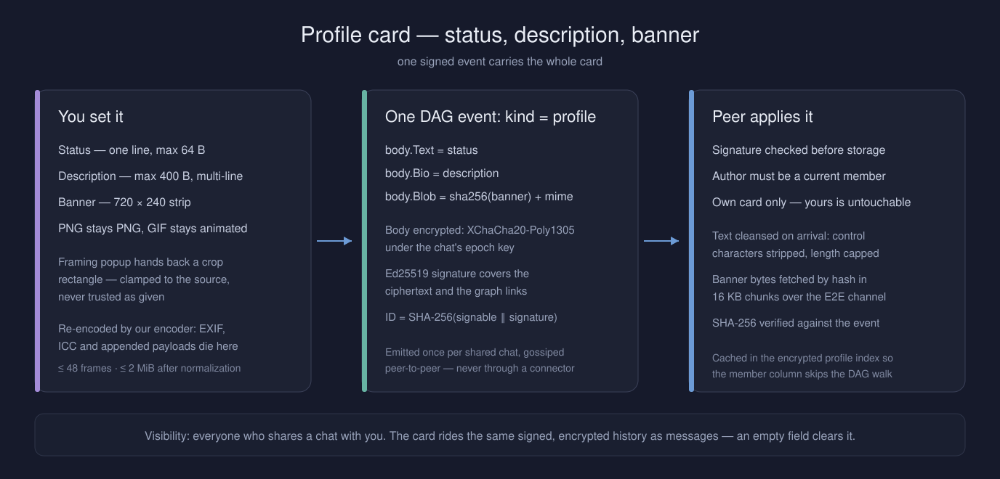

Status, description and banner travel as **one signed event**, so a peer who missed an update never ends up with half a card. Limits: status ≤ 64 B, description ≤ 400 B, banner normalized to 720 × 240 (animated GIF kept, ≤ 48 frames, ≤ 2 MiB).

Avatars and banners are framed in-app before they are sent — drag to pan, slider or wheel to zoom, and what the frame shows is exactly what lands on the profile:


Everything is re-encoded by our own encoder, which is also the cheapest possible EXIF/ICC/polyglot stripper. The card is visible to everyone who shares a chat with you — see [SECURITY.md](SECURITY.md#-profile-card-status-description-banner).

---

## 📞 Calls — mesh audio, in-call panel, 3D scene

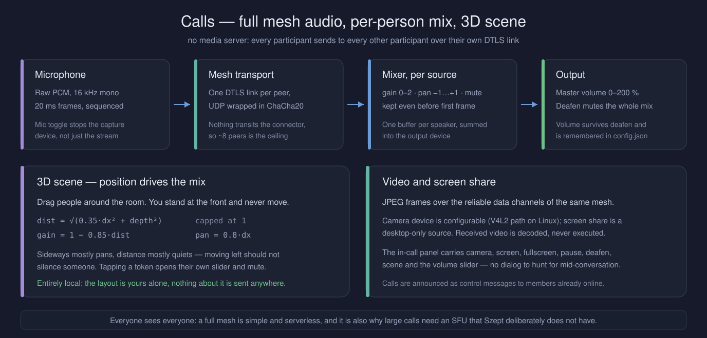

Voice is raw PCM (16 kHz mono, 20 ms frames), camera and screen share are JPEG frames, and all of it rides the same DTLS mesh as messages. No media server — which is why ~8 participants is the sensible ceiling.

The in-call panel sits under the conversation: camera, screen share, fullscreen, pause, deafen, scene, and a live output slider.


### 3D scene


Drag participants around the room. Distance quiets them, sideways position pans them:

```
dist = √(0.35·dx² + depth²)      (capped at 1)
gain = 1 − 0.85·dist             pan = 0.8·dx
```

Tapping a person opens their own volume slider and mute. All of it is **local** — your arrangement of the room is never transmitted, and muting someone tells them nothing.

The desktop client shows the same room flattened to a top-down stage (call panel → the people button): dragging still sets gain and pan, only the depth axis is a straight line instead of perspective.

---

## ⚙️ Settings

Settings is a full-window view: sections on the left, content on the right.

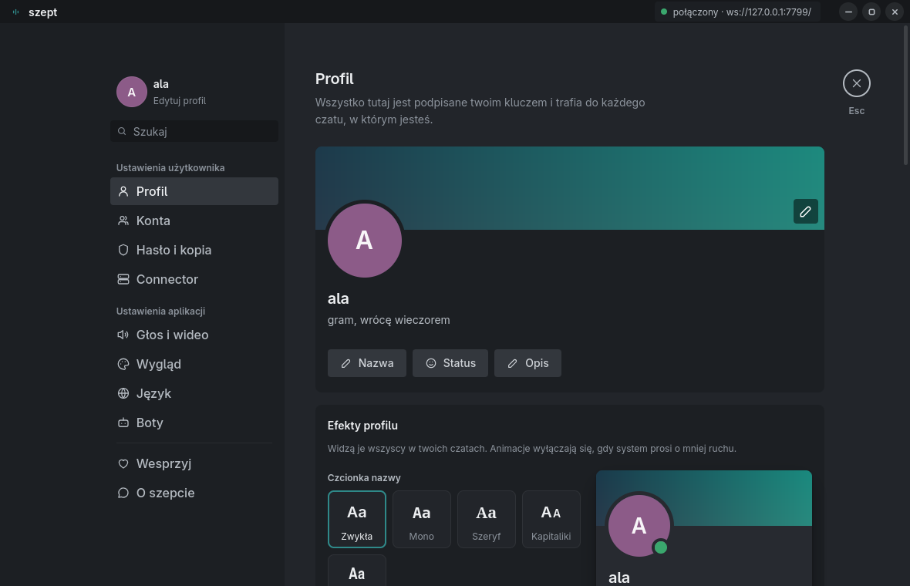

| Section | What's in it |
|---|---|
| **Nazwa / Awatar / Status i opis / Baner** | Your profile card, each with its own page; images go through the framing popup |
| **Mój kod / QR** | Your friend code as text and QR, plus a field for someone else's |
| **Backup & restore** | Save a zip (identity + live database snapshot); restore lands as a **new** account |
| **Connectory** | Active connector, saved list, dynamic lists, "Hide my IP address", "Hide my contact list from the connector" |
| **Głos i wideo** | Output volume (live, 0–200 %), camera device (V4L2 path on Linux) |
| **Hasła i szyfrowanie** | Change the identity passphrase (old one verified first — a typo must not lock you out); the database gets a new random key and is re-encrypted |
| **Konta** | Multiple identities on one device |
| **System** | Notifications, media folder, image cache |
| **Wygląd** | Accent colour — applied live, remembered in `config.json` |
| **Boty / webhooki** | Local webhook bridge |

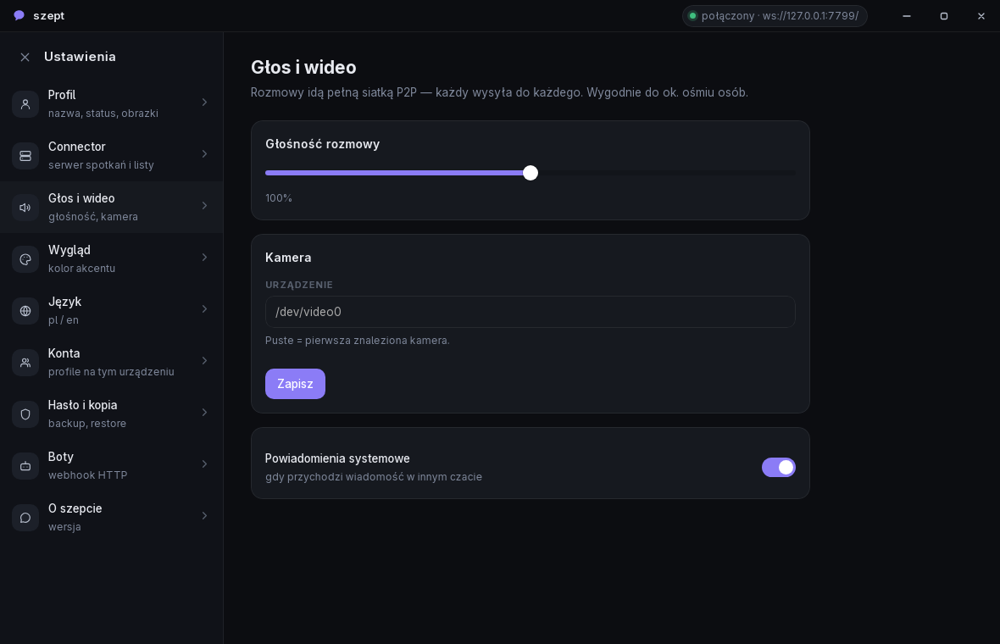
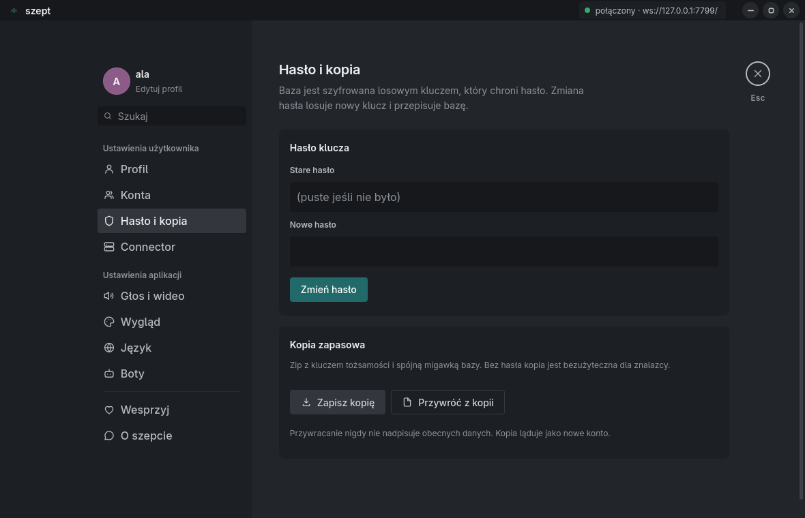

---

## 👥 Accounts & Backups

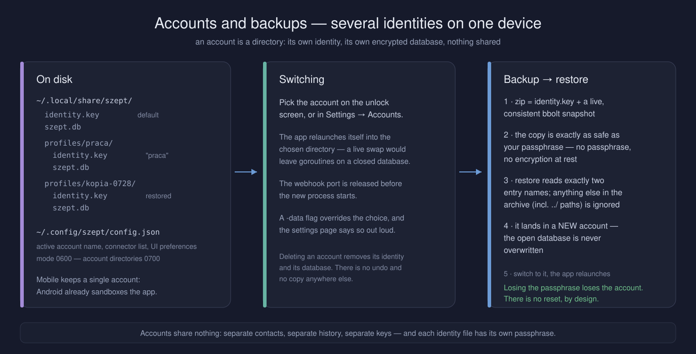

An account is a directory with its own identity and its own encrypted database. Nothing is shared between accounts — separate contacts, separate history, separate keys.

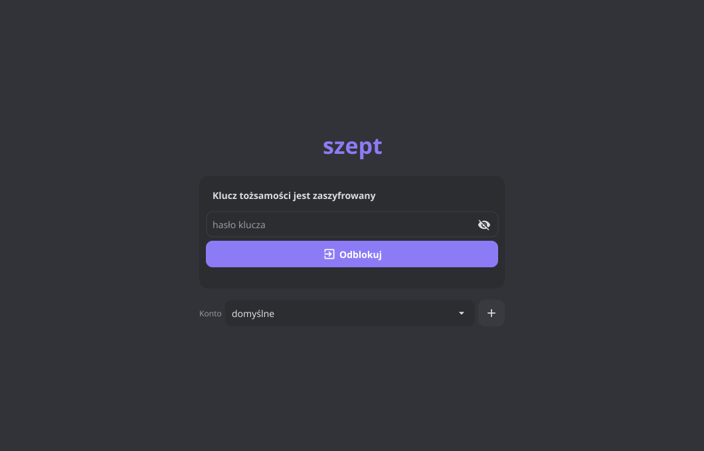

- Pick the account **on the unlock screen** (before typing any passphrase) or in Settings → Konta.
- Switching relaunches the app into the chosen directory — a live swap would leave goroutines writing to a closed database.
- Backup = zip of `identity.key` + a consistent bbolt snapshot, taken without closing the app.
- Restore reads exactly two entry names and unpacks into a **new** account — the open database is never overwritten.
- Backups are exactly as protected as your passphrase. Without one, they are plaintext to anyone who finds them.


Android keeps a single account: the platform already sandboxes the app per install.

---

## 🤖 Bots — local webhook bridge

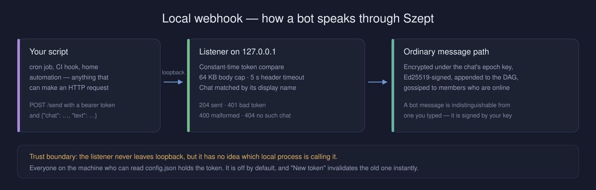

Enable it in Settings → **Boty / webhooki**, copy the token, and any script on the same machine can speak:

```bash
curl -X POST http://127.0.0.1:7780/send \
  -H "Authorization: Bearer $TOKEN" \
  -d '{"chat":"chat name","text":"hello from a bot"}'
```

`chat` is the chat ID (hex) or its name. A name only works while exactly one chat has it, because chat names are not unique.

| Response | Meaning |
|---|---|
| `204` | Sent — signed and encrypted like anything you type |
| `400` | Body isn't `{"chat":…,"text":…}` |
| `401` | Bad token |
| `404` | No chat with that name |
| `409` | Several chats share that name — pass the chat ID (hex) instead |

Bound to `127.0.0.1` only, off by default, 32-byte token compared in constant time, 64 KB body cap. The token is kept in the encrypted database, not in `config.json`. Anything on your machine that has the token can send as you, which is the feature and the risk in one sentence.


---

## 🚀 Quickstart

### Build from source

Requirements: **Go ≥ 1.22**, gcc, X11/GL headers (fyne client), and
GTK + WebKitGTK for the desktop client:

| Toolkit | Packages | Build tag |
|---|---|---|
| GTK4 (default) | `webkitgtk-6.0` / `libwebkitgtk-6.0-dev` | — |
| GTK3 | `webkit2gtk-4.1` / `libwebkit2gtk-4.1-dev` | `gtk3` |

The Makefile probes `pkg-config` and adds `-tags gtk3` by itself; override with
`make WAILS_TAGS=gtk3` (or `WAILS_TAGS=` to force GTK4).

The desktop client is pinned to `github.com/wailsapp/wails/v3` — the v3 line is
an alpha, but it is the newest one there is (there is no v4), and v2 has no
service bindings this UI is built on. `go get github.com/wailsapp/wails/v3/pkg/application@latest`
moves the pin; the frontend needs no build step either way.

```bash
make          # bin/szept-connector, bin/szept (TUI), bin/szept-wails, bin/szept-gui
make test     # go vet + full test suite
make install  # desktop entry + icon into ~/.local (re-run to update)
```

Cross builds:

```bash
make connector-windows   # pure Go, no cgo
make windows             # clients, needs mingw-w64
make android             # APK (wails), needs Android SDK + NDK 27 and a JDK
                         # release key: KEYSTORE=… KS_PASS=… KS_ALIAS=…
make release SIGNKEY=~/.ssh/szept_release
                         # reproducible connector for every platform + signed SHA256SUMS
```

Verify a release (`allowed_signers` holds `szept <published public key>`):

```bash
ssh-keygen -Y verify -f allowed_signers -I szept -n szept-release -s SHA256SUMS.sig < SHA256SUMS
sha256sum -c SHA256SUMS
```

### Run a standalone connector
```bash
./bin/szept-connector --listen :7777
# TLS: --cert cert.pem --key key.pem → clients connect via wss://
```

| Flag | Meaning |
|---|---|
| `--listen` | Listen address (`:7777`, `host:port`) |
| `--cert` / `--key` | TLS certificate — clients then use `wss://` |
| `--public-url` | This connector's public URL, announced over SNDP |
| `--seeds` | Comma-separated seed connectors to gossip with |
| `--max-peers` | Peer cap; over it, clients get a `redirect` to a neighbour |

### Join the Cebulion mesh
```bash
./bin/szept-connector --listen :7777 \
  --public-url ws://your-vps.example.com:7777 \
  --seeds ws://seed1.example.com:7777
```

### Launch & add friends

1. Start `./bin/szept` (TUI) or `./bin/szept-wails` (desktop).
2. First run asks for a name, a connector and an optional passphrase.

   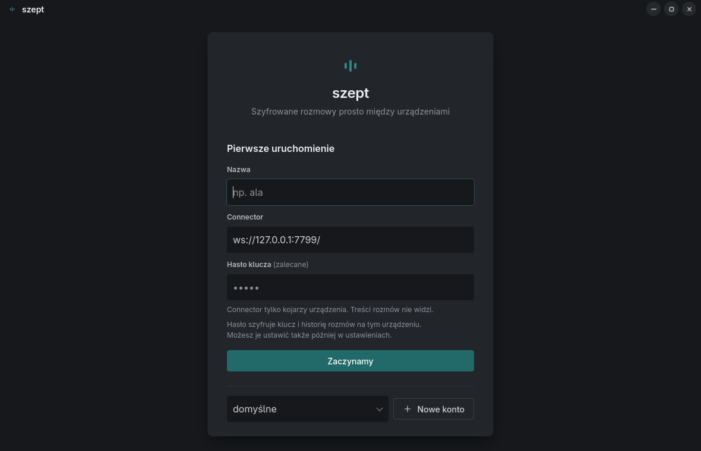
3. Share your ID — `/mycode` in TUI, `/kod` or **Mój kod / QR** in GUI.
4. Add a friend — `/friend <code>`.
5. Create a group — `/new <name>`, then invite with `/invite` (code + 6-digit PIN, valid 10 minutes, 5 attempts).

Both clients take `-data <dir>` and `-connector <url>`.

---

## 🗂️ Files & Configuration

| Path | Contents |
|---|---|
| `~/.config/szept/config.json` | Configuration, mode `0600` |
| `~/.local/share/szept/identity.key` | Ed25519 seed, encrypted if you set a passphrase, mode `0600` |
| `~/.local/share/szept/szept.db` | Fully encrypted bbolt database |
| `~/.local/share/szept/profiles/<name>/` | A second account: same two files, mode `0700` |

`XDG_DATA_HOME` is honoured if set. On Windows the data dir is `%LOCALAPPDATA%\szept` (older installs keep `~/.local/share/szept`). `tmp/` inside it holds attachments opened in an external viewer and is wiped at every start and exit.

`config.json` fields:

| Field | Meaning |
|---|---|
| `connector` | Active connector URL |
| `connectors` | Saved connectors you switch between |
| `connector_lists` | `https://` addresses of dynamic connector lists |
| `stun` | STUN servers (defaults are used when empty) |
| `media_dir` | Folder browsed by the built-in gallery |
| `profile` | Active account; empty = the default one |
| `accent` | Accent colour, hex `RRGGBB` |
| `output_vol` | Call volume, `0..2` (0 = default 1) |
| `cam_device` | Camera device, e.g. `/dev/video1` |
| `no_notify` | Silence system notifications |
| `relay_only` | Connect only through the connector's TURN relay |
| `quiet_lookup` | Look up only members of recently used chats |
| `webhook_on` / `webhook_port` | Local bot bridge (the token is in the encrypted database) |

---

## ⌨️ Commands

Both clients accept English and Polish aliases. Availability differs where the UI already covers it — reactions, delete and hide are context-menu actions in the GUI, and slash commands in the TUI.

| Command | Description | TUI | GUI |
|---|---|:--:|:--:|
| `/new <name>` · `/nowy` | Create group chat (people added later do not see earlier messages) | ✅ | ✅ |
| `/dm <friend>` | Open 1:1 chat | ✅ | ✅ |
| `/invite` · `/zapros` | One-time invite (code + PIN) | ✅ | ✅ |
| `/join <code> <pin>` · `/dolacz` | Join group from invite | ✅ | ✅ |
| `/friend <code>` · `/znajomy` | Add friend | ✅ | ✅ |
| `/mycode` · `/mojkod` · `/code` | Show your friend code | ✅ | — |
| `/kod` · `/code` | Your QR + field for someone else's code | — | ✅ |
| `/search <q>` · `/szukaj` | Search encrypted history | ✅ | ✅ |
| `/who` · `/kto` | List chat members | ✅ | ✅ |
| `/kick <name\|fingerprint>` | Remove member (rotates the epoch key). A name shared by several members removes nobody; use the fingerprint from `/who` | ✅ | ✅ |
| `/rekey` | Manual epoch key rotation | ✅ | ✅ |
| `/rename <name>` · `/zmien` | Rename chat | ✅ | ✅ |
| `/send <path>` · `/wyslij` | Send file (GUI opens the picker) | ✅ | ✅ |
| `/save <n>` · `/zapisz` | Save attachment to disk | ✅ | — |
| `/react <n> <emoji>` · `/r` | Emoji reaction | ✅ | menu |
| `/delete <n>` · `/usun` | Delete for everyone (DAG event) | ✅ | menu |
| `/hide <n>` · `/ukryj` | Hide locally | ✅ | menu |
| `/avatar <path>` · `/awatar` | Set profile picture | ✅ | ✅ |
| `/call` | Join voice call | ✅ | ✅ |
| `/leave` · `/rozlacz` · `/hangup` | Leave call | ✅ | ✅ |
| `/mic` · `/cam` · `/screen` · `/ekran` | Toggle mic / camera / screen share | ✅ | ✅ |
| `/connector [url]` | Show or change connector | ✅ | ✅ |
| `/lang <pl\|en>` · `/jezyk` | Interface language | ✅ | ✅ |
| `/me` · `/ja` | Profile and settings | — | ✅ |
| `/clear` · `/wyczysc` | Hide local system messages | — | ✅ |
| `/help` · `/pomoc` | Command list | ✅ | ✅ |
| `/quit` | Exit | ✅ | — |

---

## 🧩 Project Layout

```
cmd/connector     the rendezvous relay (pure Go, cross-compiles anywhere)
cmd/szept         terminal client (bubbletea)
cmd/szept-wails   desktop client (wails v3 — webview UI in cmd/szept-wails/frontend)
cmd/szept-gui     Android client, and the fyne desktop build it grew out of
internal/core     the brain: identity, store, connector link, sync, invites, calls
internal/event    the chat DAG — signed, hash-linked, epoch-encrypted events
internal/store    bbolt persistence; every value encrypted and location-bound
internal/p2p      WebRTC data channels + the ChaCha20 obfuscation layer
internal/connector  connector implementation and the Cebulion mesh
internal/attach   attachment/avatar/banner validation and normalization
internal/crypt    XChaCha20-Poly1305, argon2id, HKDF
internal/identity Ed25519 keypair, encrypted at rest, fingerprints
internal/media    capture and playback: PCM voice, camera, screen
internal/boot     config + identity plumbing, accounts, backup/restore
internal/i18n     interface strings (pl/en)
```

---

## 🛠️ Development

```bash
make test    # go vet ./... && go test ./... -timeout 180s
```

The screenshots in this README are produced by the app itself, so they cannot drift from the UI:

```bash
tools/shots-wails.sh                                  # desktop (wails)
SZEPT_SEED=/tmp/seed SZEPT_SHOTS=/tmp/shots \
  go test ./cmd/szept-gui -run TestShots -v           # mobile (fyne)
```

Both start from a throwaway data directory with sample chats. The mobile ones render through fyne's software canvas (no X11, no GL); the desktop ones drive a real build on a virtual `Xvfb` screen — your own desktop is never touched and never ends up in a picture. Layout regressions fail there before anyone sees them.

---

## 🔐 Security

The threat model, the guarantees and the honest limits are in **[SECURITY.md](SECURITY.md)** — including what the connector can see, what lands on your own disk, and the known trade-offs.

---

## 📄 License

[GNU General Public License v3.0](LICENSE) (GPL-3.0-or-later).

Szept is provided **as is, without any warranty** — including any warranty of security or fitness for a particular purpose — to the extent permitted by applicable law. The authors are not liable for any damage arising from its use. See sections 15 and 16 of the [license](LICENSE).

---
---

# 🇵🇱 Szept — Komunikator Peer-to-Peer z Szyfrowaniem End-to-End

> **Brak centralnych serwerów. Bez numeru telefonu. Komunikacja odporna na cenzurę.**
>
> *Szept* to komunikator peer-to-peer z pełnym szyfrowaniem end-to-end, napisany w Go. Dostępny w wersji konsolowej (**TUI**), graficznej (**GUI**) na Linuksa i Windowsa, oraz mobilnej na **Androida**.


---

## ✨ Przegląd

| Kategoria | Co dostajesz |
|---|---|
| **Szyfrowanie** | Tożsamość Ed25519 · klucze epokowe XChaCha20-Poly1305 · transport DTLS 1.2+ |
| **P2P** | Treści nigdy nie trafiają na serwer — wymiana bezpośrednia po WebRTC. |
| **Sieć Cebulion** | Rozproszona siatka connectorów z gossipem SNDP, routingiem Dijkstry i automatycznym failoverem — padnięcie dowolnego connectora nie zatrzymuje komunikatora. |
| **Obfuskacja DPI** | Każdy datagram UDP owinięty ChaCha20 ze zmiennym paddingiem — nagłówki STUN/DTLS znikają, ruch wygląda jak losowy szum. |
| **DAG** | Każdy czat to podpisany, powiązany hashami SHA-256 graf acykliczny z porządkiem Lamporta. Historia synchronizuje się automatycznie. |
| **Głos i wideo** | Rozmowy w siatce P2P (do ~8 osób), panel sterowania w rozmowie, głośność i wyciszanie pojedynczych osób, **przestrzeń dźwięku** sterująca miksem (scena 3D na Androidzie, pokój z góry na pulpicie). |
| **Profil** | Awatar, animowany baner, status i opis — jedno podpisane zdarzenie, kadrowane w aplikacji przed wysyłką. |
| **Pliki** | Podgląd inline dla grafik, GIF-ów i wideo. Duże pliki ładowane na żądanie fragmentami po 16 KB. |
| **Wiele kont** | Kilka tożsamości na jednym urządzeniu, każda z własną bazą — przełączanie z ekranu logowania. Kopia zapasowa i przywracanie z zipa. |
| **Boty** | Lokalny webhook z tokenem: dowolny skrypt na twoim komputerze wysyła wiadomość, którą szept podpisuje i szyfruje jak twoją. |
| **UX** | Kolumna członków z obecnością · wskaźniki pisania · potwierdzenia dostarczenia (`✓` / `✓✓`) · reakcje emoji · wyszukiwanie · usuwanie globalne i lokalne |

---

## 📸 Zrzuty ekranu

| Rozmowa z kolumną członków | Panel rozmowy |
|---|---|
|  |  |

| Karta profilu | Kadrowanie baneru |
|---|---|
|  |  |

| Ustawienia — konta | Ustawienia — boty |
|---|---|
|  |  |

| Scena 3D (Android) | Scena z wybraną osobą |
|---|---|
|  |  |

Wersja mobilna (ten sam kod, inna powłoka):

| Czaty | Rozmowa | Znajomi | Połączenie |
|---|---|---|---|
|  |  |  |  |

> Zrzuty generuje sama aplikacja, to nie makiety — patrz [Rozwój](#-rozwój).

---

## 🏗️ Architektura

Jedynym elementem infrastruktury jest **Connector** — ~200-liniowy, stateless relay. Mapuje `pubkey → gniazdo` i przekazuje zaszyfrowane dla odbiorcy, podpisane SDP. **Nigdy** nie widzi treści, kluczy ani członkostwa.


**Przebieg połączenia:**
1. **Rejestracja** — klient wysyła podpisany Ed25519 znacznik czasu; connector mapuje pubkey na WebSocket.
2. **Sygnalizacja** — oferta SDP (odcisk certyfikatu DTLS + 32-bajtowy klucz obfuskacji) podpisana Ed25519 i zaszyfrowana dla odbiorcy (X25519 + XChaCha20-Poly1305), connector jej nie odczyta; okno świeżości ±2 minuty, jawny adresat, rozstrzyganie kolizji (wygrywa niższy pubkey).
3. **Połączenie** — handshake DTLS 1.2+ bezpośrednio między peerami. Certyfikat związany z tożsamością — connector nie zrobi MITM.
4. **Synchronizacja** — peery wymieniają hashe czół DAG i dociągają brakujące zdarzenia szyfrowanym kanałem.

**Czy connector musi stać cały czas?** Tylko na czas zestawienia łącza. Kiedy kanał DTLS już istnieje, wiadomości, pliki i rozmowy lecą bezpośrednio między peerami — connector może paść, a rozmowa trwa dalej. Potrzebny jest przy każdym *nowym* połączeniu i po każdym zerwaniu (uśpienie, zmiana sieci, rebind NAT), bo nie ma zapasowego punktu spotkania: mDNS w ICE jest wyłączony, a bezpośredniego dzwonienia po IP nie ma. Pisanie bez połączenia działa — zdarzenia lądują w lokalnym DAG i przechodzą przez `sync`, kiedy łącze wróci, ale dostarczenie wymaga, żeby obie strony były online w tym samym czasie (nie ma skrzynki store-and-forward). Powrót dzieje się sam: klient wznawia sesję z backoffem i co 30 s ponawia łączenie ze znanymi peerami. Szczegóły w [SECURITY.md](SECURITY.md#when-the-connector-is-needed).

---

## 🧅 Sieć Cebulion — Rozproszona Siatka Connectorów

Connector może działać sam lub dołączyć do **Sieci Cebulion** — rozproszonej siatki connectorów. Jeśli jakiś connector padnie lub zostanie zdjęty, reszta sieci przejmuje routing sygnałów. Klient automatycznie przełącza się na żywe węzły.


**Jak działa:**
- **Otwarta siatka** — każdy może postawić connector i dołączyć przez `--seeds`. Nie ma wspólnego hasła, bo w sieci wolontariuszy znałby je też cenzor. Wrogi węzeł jest ograniczony: treść jest podpisana end-to-end, każde gniazdo meshu ma limit, a zalew idzie kilkoma drogami. `--mesh-secret` robi prywatną siatkę zaufanych węzłów, `--mesh=false` zostawia connector samodzielny. `--private-gossip` ukrywa węzeł przed przeszukiwaniem meshu: nie podaje sąsiadów (poza węzłami z `--mesh-secret`), nie wysyła list przekierowań i prosi sąsiadów, żeby nie podawali dalej jego adresu. Dalej dołącza przez `--seeds` i przekazuje ruch.
- **Gossip** — co 15 sekund connector pyta sąsiadów o innych przez to samo gniazdo WebSocket. Odpowiedź ma najwyżej 8 adresów, wybranych według sieci /16 pytającego, więc nikt nie dostaje całej listy z jednego miejsca.
- **Wyszukiwanie** — gdy klient pyta o klucz, którego connector nie ma u siebie, connector pyta siatkę (`mesh_lookup`). Klienci na różnych connectorach znajdują się nawzajem.
- **Przekazywanie** — sygnał idzie do sąsiada zapamiętanego dla klucza i do najwyżej 4 innych (TTL + TraceID ucinają pętle)
- **Failover** — padnięcie węzła = klient próbuje fallback URL-i (bez degradacji `wss://` do `ws://`)
- **Load balancing** — przeciążony connector odsyła klienta do 3 sąsiadów

**Ukrywanie connectora przed cenzorem.** Connector odpowiada tylko na tajnej ścieżce (losowa, zapisana w `connector.path`, wypisana przy starcie). Każde inne zapytanie dostaje zwykłe 404, a z `--decoy https://jakas-strona` treść tej strony. Nie ma strony statusu. Z `--domain` connector działa jako `wss://` na porcie 443 z automatycznym certyfikatem Let's Encrypt, więc z zewnątrz wygląda jak zwykła strona HTTPS.

**Przekaźnik (TURN) i ukrywanie IP.** Connector ze znanym adresem publicznym (`--domain`, `--public-url` albo `--turn <IP>`) uruchamia też STUN i TURN na UDP, na swoim porcie. Klienci używają wtedy connectora zamiast STUN-a Google, a osoby za CGNAT operatora łączą się przez przekaźnik. Opcja **Ustawienia → Connector → „Ukryj mój adres IP”** (`relay_only` w `config.json`) puszcza każde połączenie tylko przez przekaźnik, więc rozmówcy widzą adres connectora, nigdy Twój. Operator connectora widzi wtedy, z kim, kiedy i ile rozmawiasz (nigdy treści), dlatego aplikacja prosi o wyraźną zgodę i informuje rozmówcę, że połączenie idzie przez przekaźnik. `--turn off` wyłącza przekaźnik, a `--turn-rate` ogranicza jego przepustowość dla wszystkich razem (KB/s w każdą stronę, domyślnie 2048, `0` = bez limitu).

**Historia dla nowych osób.** Nowa grupa ukrywa wcześniejsze wiadomości przed osobami dodanymi później: dostają klucze od momentu dołączenia, a właściciel po każdym dodaniu automatycznie zmienia klucz. Zaznacz „Nowi członkowie widzą wcześniejszą historię” przy tworzeniu grupy, żeby to wyłączyć. Nowa osoba czyta i pisze, gdy klient właściciela zmieni klucz.

**Ukrywanie listy kontaktów.** Domyślnie aplikacja co 30 s pyta connector, czy każdy kontakt jest online, więc connector poznaje całą Twoją listę kontaktów. Opcja **Ustawienia → Connector → „Ukryj listę kontaktów przed connectorem”** (`quiet_lookup`) pyta tylko o osoby z czatów otwartych albo używanych w ostatnich 15 minutach. Kropki obecności pozostałych osób przestają być aktualne.

**Uruchomienie connectora w siatce:**
```bash
./bin/szept-connector --domain c1.example.com \
  --seeds wss://c2.example.com/9f2c…,wss://c3.example.com/41ab… \
  --decoy https://example.org
# klienci i inne węzły używają adresu wypisanego przy starcie: wss://c1.example.com/<tajna ścieżka>
```

### Przełączanie connectorów w aplikacji


Ustawienia → **Connectory** trzymają listę adresów do przełączania oraz opcjonalne **dynamiczne listy**: adres `https://` zwracający jeden `ws://` na linię. „Odśwież” dopisuje nowe wpisy do listy — sam z siebie nigdzie nie łączy. Limity: tylko `https://`, bez przekierowań, 64 KB na listę, 8 s timeout, tylko linie `ws://` i `wss://`. Co host listy widzi, a czego nie — [SECURITY.md](SECURITY.md#switching-connectors-and-dynamic-connector-lists).

---

## 🔒 Obfuskacja Ruchu

Pod restrykcyjnymi firewallami *Szept* owija cały ruch P2P w warstwę obfuskacji ChaCha20. Pakiety na łączu wyglądają jak losowy szum o zmiennej długości — systemy DPI nie rozpoznają sygnatur WebRTC.


- **Klucz na połączenie** — 32 bajty od strony ofertującej, w podpisanej Ed25519 ofercie SDP zaszyfrowanej dla odbiorcy.
- **Format** — `nonce(12B) || ChaCha20(len(2B) || dane || padding(0–64B))`. Bez MAC — uwierzytelnia DTLS pod spodem.
- **Omijanie STUN** — ruch do publicznych serwerów STUN idzie bez obfuskacji, żeby ICE działało.
- **mDNS wyłączony** — żadnego multicastu `.local` obok zaszyfrowanego strumienia.

---

## 🪪 Tożsamość, znajomi i karta profilu

### Kod zawiera klucz, nie imię

Kod znajomego to `{klucz publiczny, podpowiedź connectora}` — **nic więcej**. Kody trafiają na zrzuty ekranu, zdjęcia QR i do schowka, więc niosą tylko to, co potrzebne, żeby cię znaleźć. Nazwa dociera później, już szyfrowanym łączem, i tylko dla osób, które mają cię na liście.

Skoro nazwa jest ogłaszana, a nie dowodzona, szept zachowuje ślad: każda nazwa siedzi w podpisanym DAG (zdarzenia `nick`), a ekran profilu wypisuje je od najstarszej. Ktoś, kto przemianuje się na znajomego, zostawia widoczny dla wszystkich ślad. Odcisk klucza (`VHGH-S7W3-LAUJ-OIKH`) to jedyna rzecz warta porównania poza aplikacją.

### Karta profilu


Status, opis i baner idą w **jednym podpisanym zdarzeniu**, więc peer, który przegapił aktualizację, nigdy nie ma pół karty. Limity: status ≤ 64 B, opis ≤ 400 B, baner normalizowany do 720 × 240 (animowany GIF zachowany, ≤ 48 klatek, ≤ 2 MiB).

Awatary i banery kadrujesz w aplikacji — przeciąganie przesuwa, suwak (albo kółko myszy) przybliża, a ramka pokazuje dokładnie to, co wyląduje na profilu:


Wszystko jest przekodowane naszym enkoderem, co przy okazji jest najtańszym możliwym usuwaniem EXIF, ICC i doklejonych ładunków. Kartę widzi każdy, z kim dzielisz czat — szczegóły w [SECURITY.md](SECURITY.md#-profile-card-status-description-banner).

---

## 📞 Rozmowy — siatka, panel i scena 3D


Głos to surowe PCM (16 kHz mono, ramki 20 ms), kamera i ekran to klatki JPEG. Wszystko idzie tą samą siatką DTLS co wiadomości. Bez serwera mediów — dlatego ~8 uczestników to rozsądny sufit.

Panel rozmowy siedzi pod konwersacją: kamera, ekran, pełny ekran, pauza, wyciszenie wyjścia, scena i suwak głośności.


### Scena 3D


Przeciągasz uczestników po pokoju. Odległość ścisza, pozycja w bok panoramuje:

```
dist = √(0.35·dx² + depth²)      (obcięte do 1)
gain = 1 − 0.85·dist             pan = 0.8·dx
```

Dotknięcie osoby otwiera jej suwak głośności i wyciszenie. Całość jest **lokalna** — twoje ustawienie pokoju nigdzie nie leci, a wyciszenie kogoś nie mówi mu o tym nic.

Klient na pulpicie pokazuje ten sam pokój spłaszczony do widoku z góry (panel rozmowy → przycisk z osobami): przeciąganie dalej ustawia głośność i panoramę, tylko oś głębi jest linią zamiast perspektywy.

---

## ⚙️ Ustawienia

Ustawienia to widok na całe okno: sekcje po lewej, treść po prawej.


| Sekcja | Co w niej jest |
|---|---|
| **Nazwa / Awatar / Status i opis / Baner** | Karta profilu, każdy element ma swoją stronę; obrazy przechodzą przez kadrowanie |
| **Mój kod / QR** | Twój kod znajomego tekstem i jako QR, plus pole na cudzy |
| **Backup & restore** | Zapis zipa (tożsamość + migawka bazy); przywracanie ląduje jako **nowe** konto |
| **Connectory** | Aktywny connector, zapisana lista, dynamiczne listy, „Ukryj mój adres IP”, „Ukryj listę kontaktów przed connectorem” |
| **Głos i wideo** | Głośność wyjścia (na żywo, 0–200 %), urządzenie kamery (ścieżka V4L2) |
| **Hasła i szyfrowanie** | Zmiana hasła tożsamości (stare weryfikowane — literówka nie może odciąć konta); baza dostaje nowy losowy klucz i jest szyfrowana od nowa |
| **Konta** | Wiele tożsamości na jednym urządzeniu |
| **System** | Powiadomienia, folder multimediów, cache obrazków |
| **Wygląd** | Kolor akcentu — działa od razu, zapamiętany w `config.json` |
| **Boty / webhooki** | Lokalny most webhooka |


---

## 👥 Konta i kopie zapasowe


Konto to katalog z własną tożsamością i własną zaszyfrowaną bazą. Konta nie dzielą niczego — osobne kontakty, osobna historia, osobne klucze.


- Konto wybierasz **na ekranie logowania** (zanim wpiszesz jakiekolwiek hasło) albo w Ustawieniach → Konta.
- Przełączenie uruchamia aplikację od nowa na wybranym katalogu — podmiana na żywo zostawiłaby gorutyny piszące do zamkniętej bazy.
- Kopia = zip z `identity.key` i spójną migawką bazy, robioną bez zamykania aplikacji.
- Przywracanie czyta dokładnie dwie nazwy wpisów i rozpakowuje je do **nowego** konta — otwarta baza nigdy nie jest nadpisywana.
- Kopia jest dokładnie tak chroniona jak twoje hasło. Bez hasła to jawny plik dla każdego, kto go znajdzie.


Android trzyma jedno konto — system i tak izoluje aplikację.

---

## 🤖 Boty — lokalny webhook


Włącz w Ustawieniach → **Boty / webhooki**, skopiuj token, i dowolny skrypt na tym komputerze może pisać:

```bash
curl -X POST http://127.0.0.1:7780/send \
  -H "Authorization: Bearer $TOKEN" \
  -d '{"chat":"nazwa czatu","text":"cześć z bota"}'
```

`chat` to ID czatu (hex) albo nazwa. Nazwa działa tylko, dopóki ma ją dokładnie jeden czat.

| Odpowiedź | Znaczenie |
|---|---|
| `204` | Wysłane — podpisane i zaszyfrowane jak każda twoja wiadomość |
| `400` | Ciało nie jest `{"chat":…,"text":…}` |
| `401` | Zły token |
| `404` | Nie ma czatu o tej nazwie |
| `409` | Kilka czatów ma tę nazwę — podaj ID czatu (hex) |

Nasłuch tylko na `127.0.0.1`, domyślnie wyłączony, 32-bajtowy token porównywany w stałym czasie, limit ciała 64 KB. Token leży w zaszyfrowanej bazie, nie w `config.json`. Wszystko na twoim komputerze, co zna token, może wysyłać jako ty — to jednocześnie cała funkcja i całe ryzyko.


---

## 🚀 Szybki start

### Budowanie ze źródeł

Wymagania: **Go ≥ 1.22**, gcc, nagłówki X11/GL (klient fyne) oraz
GTK + WebKitGTK dla klienta pulpitowego:

| Toolkit | Pakiety | Tag budowania |
|---|---|---|
| GTK4 (domyślnie) | `webkitgtk-6.0` / `libwebkitgtk-6.0-dev` | — |
| GTK3 | `webkit2gtk-4.1` / `libwebkit2gtk-4.1-dev` | `gtk3` |

Makefile sam sprawdza `pkg-config` i w razie potrzeby dokłada `-tags gtk3`;
nadpiszesz to przez `make WAILS_TAGS=gtk3` (albo `WAILS_TAGS=` dla GTK4).

Klient pulpitowy stoi na `github.com/wailsapp/wails/v3` — linia v3 jest alfą,
ale nowszej nie ma (v4 nie istnieje), a v2 nie ma bindowania serwisów, na
którym opiera się ten interfejs. `go get github.com/wailsapp/wails/v3/pkg/application@latest`
przesuwa wersję; frontend i tak nie potrzebuje żadnego kroku budowania.

```bash
make          # bin/szept-connector, bin/szept (TUI), bin/szept-wails, bin/szept-gui
make test     # go vet + testy
make install  # wpis w menu aplikacji i ikona w ~/.local
```

Budowanie skrośne:

```bash
make connector-windows   # czysty Go, bez cgo
make windows             # klienci, wymaga mingw-w64
make android             # APK (wails), wymaga Android SDK + NDK 27 i JDK
                         # klucz wydania: KEYSTORE=… KS_PASS=… KS_ALIAS=…
make release SIGNKEY=~/.ssh/szept_release
                         # powtarzalny connector na każdą platformę + podpisane SHA256SUMS
```

Sprawdzenie wydania (`allowed_signers` zawiera `szept <opublikowany klucz publiczny>`):

```bash
ssh-keygen -Y verify -f allowed_signers -I szept -n szept-release -s SHA256SUMS.sig < SHA256SUMS
sha256sum -c SHA256SUMS
```

### Samodzielny connector
```bash
./bin/szept-connector --listen :7777
# TLS: --cert cert.pem --key key.pem → klienci łączą się przez wss://
```

| Flaga | Znaczenie |
|---|---|
| `--listen` | Adres nasłuchu (`:7777`, `host:port`) |
| `--cert` / `--key` | Certyfikat TLS — wtedy klienci używają `wss://` |
| `--public-url` | Publiczny adres tego connectora, ogłaszany po SNDP |
| `--seeds` | Lista connectorów startowych (po przecinku) |
| `--max-peers` | Limit peerów; powyżej klient dostaje `redirect` do sąsiada |

### Start i dodawanie znajomych

1. Uruchom `./bin/szept` (TUI) albo `./bin/szept-wails` (pulpit).
2. Pierwsze uruchomienie pyta o nazwę, connector i opcjonalne hasło.

   
3. Pokaż swój kod — `/mojkod` w TUI, `/kod` albo **Mój kod / QR** w GUI.
4. Dodaj znajomego — `/znajomy <kod>`.
5. Załóż grupę — `/nowy <nazwa>`, zaproś przez `/zapros` (kod + 6-cyfrowy PIN, ważny 10 minut, 5 prób).

Oba klienty przyjmują `-data <katalog>` i `-connector <adres>`.

---

## 🗂️ Pliki i konfiguracja

| Ścieżka | Zawartość |
|---|---|
| `~/.config/szept/config.json` | Konfiguracja, tryb `0600` |
| `~/.local/share/szept/identity.key` | Ziarno Ed25519, zaszyfrowane jeśli ustawisz hasło, tryb `0600` |
| `~/.local/share/szept/szept.db` | W całości zaszyfrowana baza bbolt |
| `~/.local/share/szept/profiles/<nazwa>/` | Drugie konto: te same dwa pliki, tryb `0700` |

`XDG_DATA_HOME` jest respektowane. Na Windows katalog danych to `%LOCALAPPDATA%\szept` (starsze instalacje zostają w `~/.local/share/szept`). Podkatalog `tmp/` trzyma załączniki otwarte w zewnętrznej przeglądarce i jest czyszczony przy każdym starcie i wyjściu.

Pola `config.json`:

| Pole | Znaczenie |
|---|---|
| `connector` | Aktywny adres connectora |
| `connectors` | Zapisane connectory do przełączania |
| `connector_lists` | Adresy `https://` dynamicznych list |
| `stun` | Serwery STUN (puste = domyślne) |
| `media_dir` | Folder przeglądany przez wbudowaną galerię |
| `profile` | Aktywne konto; puste = domyślne |
| `accent` | Kolor akcentu, hex `RRGGBB` |
| `output_vol` | Głośność rozmów, `0..2` (0 = domyślne 1) |
| `cam_device` | Urządzenie kamery, np. `/dev/video1` |
| `no_notify` | Wyciszenie powiadomień systemowych |
| `relay_only` | Łączenie tylko przez przekaźnik TURN connectora |
| `quiet_lookup` | Pytanie tylko o członków ostatnio używanych czatów |
| `webhook_on` / `webhook_port` | Lokalny most dla botów (token jest w zaszyfrowanej bazie) |

---

## ⌨️ Komendy

Oba klienty przyjmują polskie i angielskie aliasy. Dostępność różni się tam, gdzie interfejs robi to sam — reakcje, usuwanie i ukrywanie są w GUI pozycjami menu, a w TUI komendami.

| Komenda | Opis | TUI | GUI |
|---|---|:--:|:--:|
| `/nowy <nazwa>` · `/new` | Utwórz grupę (osoby dodane później nie widzą wcześniejszych wiadomości) | ✅ | ✅ |
| `/dm <znajomy>` | Czat na dwoje | ✅ | ✅ |
| `/zapros` · `/invite` | Jednorazowe zaproszenie (kod + PIN) | ✅ | ✅ |
| `/dolacz <kod> <pin>` · `/join` | Dołącz do grupy | ✅ | ✅ |
| `/znajomy <kod>` · `/friend` | Dodaj znajomego | ✅ | ✅ |
| `/mojkod` · `/mycode` · `/code` | Pokaż swój kod | ✅ | — |
| `/kod` · `/code` | Twój QR i pole na cudzy kod | — | ✅ |
| `/szukaj <fraza>` · `/search` | Szukaj w historii | ✅ | ✅ |
| `/kto` · `/who` | Członkowie czatu | ✅ | ✅ |
| `/kick <nazwa\|odcisk>` | Usuń członka (rotuje klucz epoki). Gdy nazwę ma kilka osób, nikt nie jest usuwany; podaj odcisk z `/kto` | ✅ | ✅ |
| `/rekey` | Ręczna rotacja klucza epoki | ✅ | ✅ |
| `/zmien <nazwa>` · `/rename` | Zmień nazwę czatu | ✅ | ✅ |
| `/wyslij <ścieżka>` · `/send` | Wyślij plik (GUI otwiera wybierak) | ✅ | ✅ |
| `/zapisz <nr>` · `/save` | Zapisz załącznik na dysk | ✅ | — |
| `/r <nr> <emoji>` · `/react` | Reakcja emoji | ✅ | menu |
| `/usun <nr>` · `/delete` | Usuń u wszystkich (zdarzenie DAG) | ✅ | menu |
| `/ukryj <nr>` · `/hide` | Ukryj lokalnie | ✅ | menu |
| `/awatar <ścieżka>` · `/avatar` | Ustaw awatar | ✅ | ✅ |
| `/call` | Dołącz do rozmowy | ✅ | ✅ |
| `/rozlacz` · `/leave` · `/hangup` | Wyjdź z rozmowy | ✅ | ✅ |
| `/mic` · `/cam` · `/ekran` · `/screen` | Mikrofon / kamera / ekran | ✅ | ✅ |
| `/connector [adres]` | Pokaż albo zmień connector | ✅ | ✅ |
| `/lang <pl\|en>` · `/jezyk` | Język interfejsu | ✅ | ✅ |
| `/ja` · `/me` | Profil i ustawienia | — | ✅ |
| `/wyczysc` · `/clear` | Schowaj komunikaty systemowe | — | ✅ |
| `/pomoc` · `/help` | Lista komend | ✅ | ✅ |
| `/quit` | Wyjście | ✅ | — |

---

## 🧩 Układ projektu

```
cmd/connector     relay spotkań (czysty Go, kompiluje się wszędzie)
cmd/szept         klient terminalowy (bubbletea)
cmd/szept-wails   klient pulpitowy (wails v3 — interfejs w cmd/szept-wails/frontend)
cmd/szept-gui     klient Android i pulpitowa wersja fyne, z której wyrósł
internal/core     mózg: tożsamość, baza, łącze do connectora, sync, zaproszenia, rozmowy
internal/event    DAG czatu — podpisane, powiązane hashami, szyfrowane zdarzenia
internal/store    trwałość bbolt; każda wartość szyfrowana i związana z miejscem
internal/p2p      kanały danych WebRTC + warstwa obfuskacji ChaCha20
internal/connector  implementacja connectora i siatki Cebulion
internal/attach   walidacja i normalizacja załączników, awatarów i banerów
internal/crypt    XChaCha20-Poly1305, argon2id, HKDF
internal/identity para kluczy Ed25519, szyfrowana na dysku, odciski
internal/media    nagrywanie i odtwarzanie: PCM, kamera, ekran
internal/boot     konfiguracja i tożsamość, konta, kopie zapasowe
internal/i18n     teksty interfejsu (pl/en)
```

---

## 🛠️ Rozwój

```bash
make test    # go vet ./... && go test ./... -timeout 180s
```

Zrzuty ekranu w tym README robi sama aplikacja, więc nie mogą się rozjechać z interfejsem:

```bash
tools/shots-wails.sh                                  # pulpit (wails)
SZEPT_SEED=/tmp/seed SZEPT_SHOTS=/tmp/shots \
  go test ./cmd/szept-gui -run TestShots -v           # telefon (fyne)
```

Oba zaczynają od jednorazowego katalogu danych z przykładowymi czatami. Mobilne rysuje programowe płótno fyne (bez X11 i GL), a pulpitowe — prawdziwy klient na wirtualnym ekranie `Xvfb`: twój pulpit nie jest ruszany i nie trafia na żaden obrazek. Zepsuty układ wywala się tam, zanim ktokolwiek go zobaczy.

---

## 🔐 Bezpieczeństwo

Model zagrożeń, gwarancje i uczciwie wypisane ograniczenia siedzą w **[SECURITY.md](SECURITY.md)** — łącznie z tym, co widzi connector, co ląduje na twoim dysku i jakie kompromisy są świadome.

---

## 📄 Licencja

[GNU General Public License v3.0](LICENSE) (GPL-3.0-or-later).

Szept jest dostarczany **„tak jak jest”, bez żadnej gwarancji**, w tym gwarancji bezpieczeństwa i przydatności do określonego celu, w zakresie dozwolonym przez prawo. Autorzy nie odpowiadają za szkody wynikłe z jego użycia. Szczegóły w punktach 15 i 16 [licencji](LICENSE).
