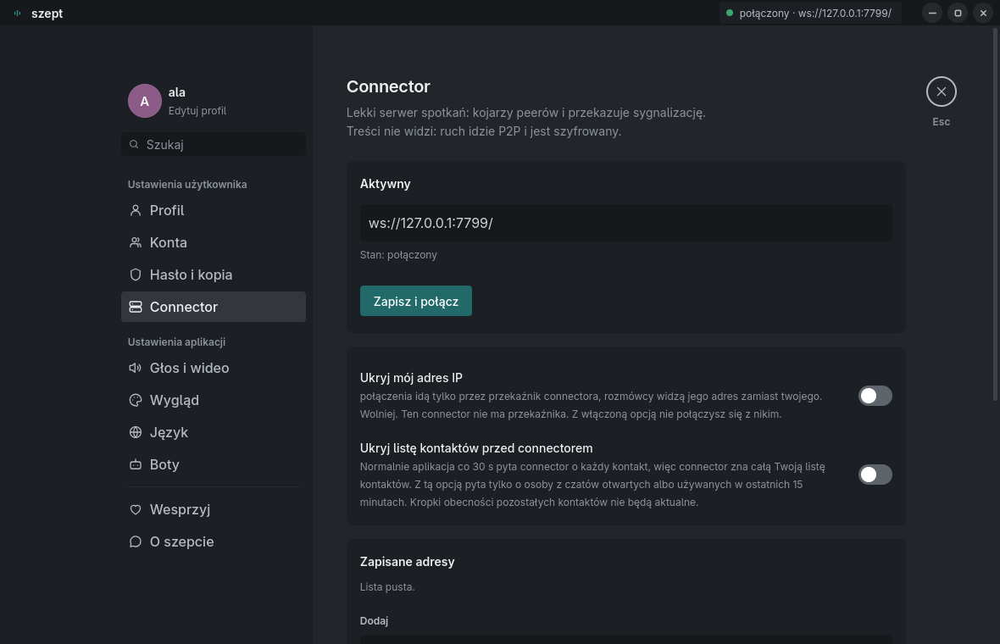
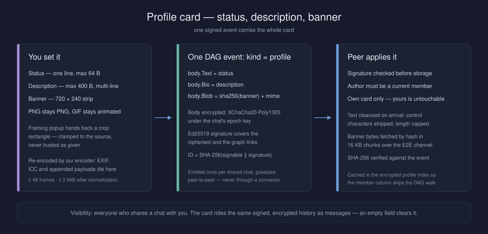
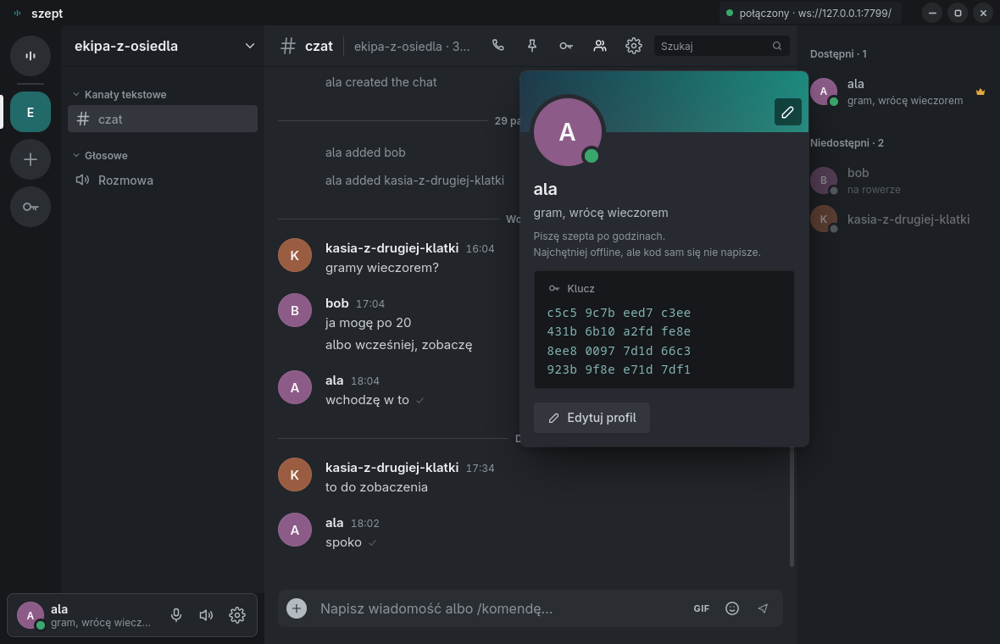
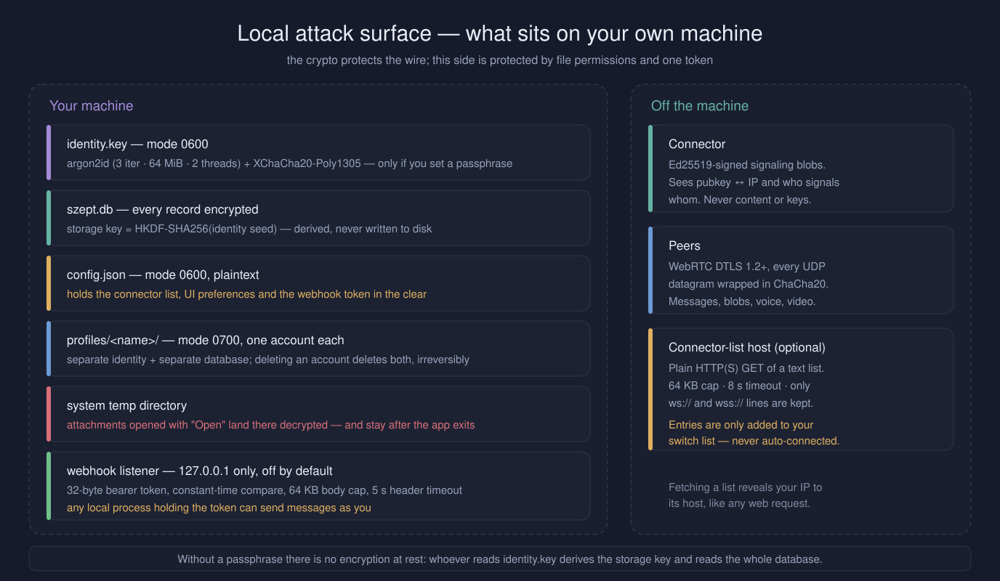
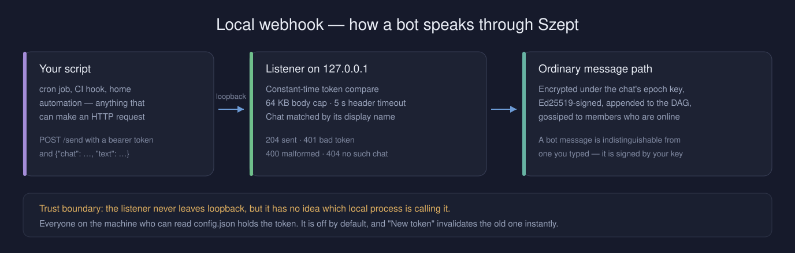
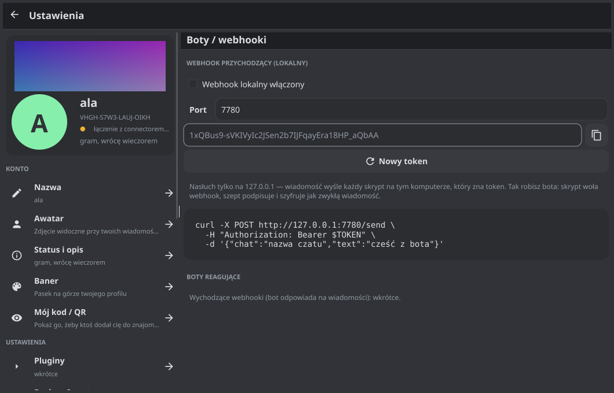
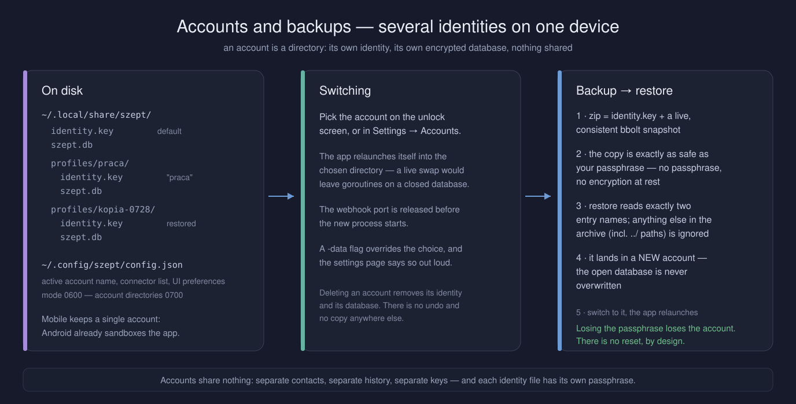
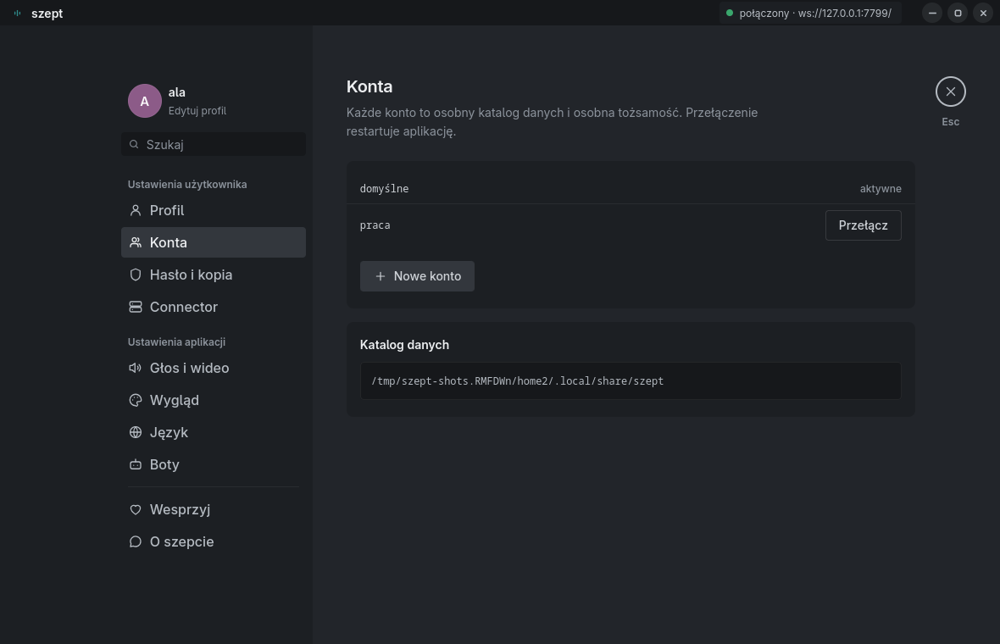
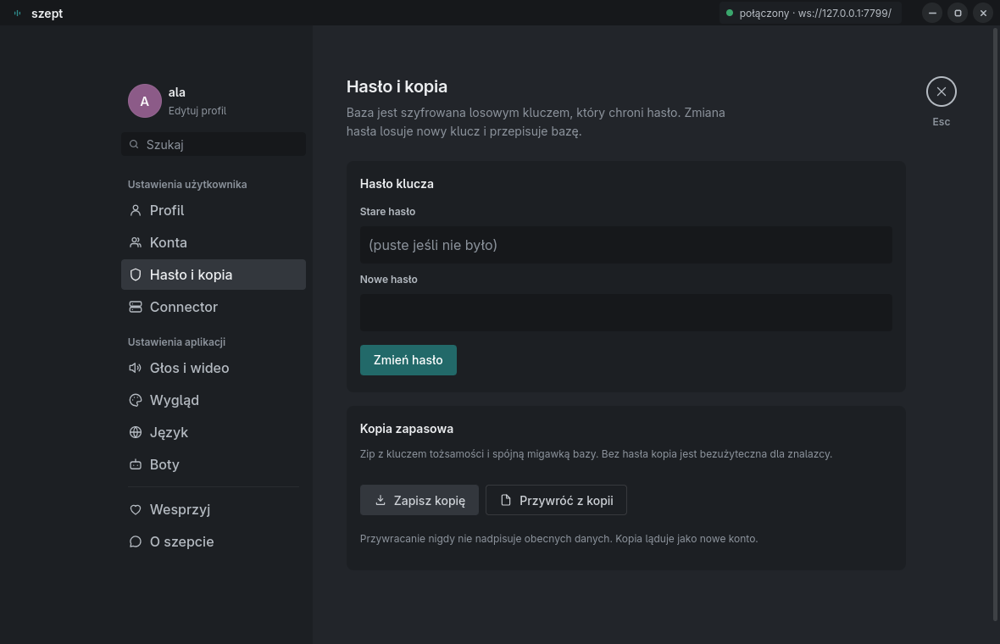
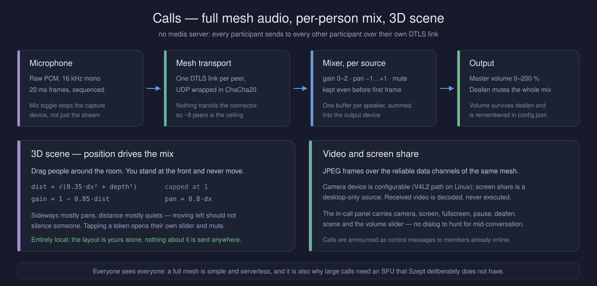

# 🔐 Security Model

> **The only party you need to trust is the person you're talking to.**
> No server ever holds your keys, your messages, or your contact list.

---

## 🔑 Identity

Every user is an **Ed25519 keypair**. That's the entire identity.

- Key file at rest: `SZEPT1` magic + 16-byte salt + `crypt.Seal(argon2id(passphrase, salt, 3 iter, 64 MiB, 2 threads), seed || name)`.
- Stored `0600`. Fingerprint = SHA-256 of pubkey → base32, displayed as `XXXX-XXXX-XXXX-XXXX`.
- Friend and invite codes **embed the full public key** — no TOFU, no trusting the server. MITM at invite time requires tampering with the code outside the app.
- Storage key: `HKDF-SHA256(seed, "szept-storage-v1")` — deterministic, never stored directly.

### Names are hints; the key is the identity

- **A friend code carries no name.** It is `{pubkey, connector hint}` only. Codes travel through screenshots, QR photos and clipboards, and a name in there is free metadata for anyone who sees the picture. Until a name arrives, the contact shows as the first 9 characters of the fingerprint.
- The display name arrives over the **already-authenticated E2E link** (`hello`), and is accepted **only for someone already on your friend list**, after `safeName()` (control characters stripped, ≤ 64 B, single line). A stranger cannot rename anybody.
- Inside a chat, names live in the **signed DAG**: the genesis event carries the creator's, every later change is a `nick` event. `NickHistory()` replays them, so a peer who swaps their display name mid-conversation leaves a visible trail — the profile screen lists every name that person has announced, oldest first.
- The fingerprint is always one tap away and is the only thing worth comparing out of band.

---

## 🔒 Cryptographic Architecture


### Layer 1: Identity

| Primitive | Usage |
|---|---|
| Ed25519 | Keypair = identity; signs events, SDP offers, registrations |
| argon2id | Passphrase → key derivation (3 iterations, 64 MiB, 2 threads) |
| XChaCha20-Poly1305 | Encrypts key file at rest |
| HKDF-SHA256 | Derives storage key and metadata keys from identity seed |

### Layer 2: Transport (P2P)

- Connections: **WebRTC DTLS 1.2+** via [pion/webrtc](https://github.com/pion/webrtc), NAT traversal via ICE/STUN.
- SDP offers contain the DTLS certificate fingerprint **and a 32-byte ChaCha20 obfuscation key** (`sigPayload.Obf`).
- Every offer is **Ed25519-signed by the sender**, and the receiver verifies:
  1. Signature against sender's known pubkey
  2. `From` matches the connector's `from` stamp
  3. `To` matches our own pubkey (explicit addressee)
  4. Timestamp within ±2 minutes (freshness)
  5. `kind + from + connID` not seen before (replay filter)
- **Glare handling**: simultaneous offers → lower pubkey's offer wins, loser abandons.
- **No TURN relay**. The connector is signaling-only — payload bytes never transit it.
- Result: every data channel is an authenticated, encrypted E2E pipe between two known identities.

### Layer 3: Chat Events (DAG)

Each event in the chat DAG:
- Has its body encrypted with **XChaCha20-Poly1305** under the current **epoch key**, using `signable(chat, kind, author, lamport, epoch, parents)` (with empty Box) as AEAD associated data.
- Is **Ed25519-signed** — signature covers the signable bytes including ciphertext.
- Has its **ID = SHA-256(signable + signature)** — content-addressed and tamper-evident.

History is **immutable** — modifying any event changes its hash and breaks every descendant.

---

## 🧅 Cebulion Network & Connector Security

### Standalone connector

A single connector works as a stateless signaling relay (~200 lines). It maps `pubkey → WebSocket` and forwards opaque blobs. It stamps `from` from the authenticated registration — clients cannot spoof the sender field.

### Cebulion mesh

Connectors can join the **Cebulion Network** — a distributed mesh providing fault tolerance and load balancing.

**The mesh is a separate, authenticated plane and it is off by default.** It exists only when the operator starts the connector with `--mesh-secret`. A socket becomes a mesh peer by sending `mesh_hello` with `HMAC-SHA256(secret, "szept-mesh-v1" || timestamp)` inside a ±60 s window; until then `mesh_signal` and `ndp_gossip` are silently dropped. Ordinary client sockets never become mesh peers, so no client — registered or not — can inject a neighbour or have a frame relayed on its behalf.

| Mechanism | Details |
|---|---|
| **SNDP Gossip** | Every 15s, connectors exchange neighbor lists, peer counts and RTT latencies via `/ndp/neighbors` (JSON, max 128 KB response). |
| **Neighbour URLs** | `ws://` / `wss://` only, max 128 chars, and never a non-public address: loopback, RFC1918, link-local (incl. `169.254.169.254`), multicast and unspecified are all refused. The check is repeated **after DNS resolution**, right before the socket opens, and HTTP redirects during gossip are refused outright — a hostname resolving to an internal IP does not get through. |
| **Relaying** | When a `signal`'s destination is not local, `mesh_signal` goes to at most 4 active neighbours. There is no routing table and no shortest-path computation; the previous Dijkstra/topology machinery was never fed a destination, so it only ever broadcast — it was removed rather than left as an amplifier with a public topology endpoint. |
| **Loop prevention** | Each `mesh_signal` carries a random 16-char hex `TraceID` (max 64 chars accepted) and `TTL` (default 5, decremented per hop). Seen traces are deduplicated for 5 minutes and capped at 100 000 entries — past the cap frames are dropped, never queued. |
| **`from` on a relayed frame** | A routing hint, not an identity. Only the Ed25519 signature inside the payload (`p2p.onSignal`) says who sent something. |
| **Load shedding** | When `--max-peers` is hit, new clients get a `redirect` message with active neighbor URLs and the connection closes. Client appends these to `FallbackURLs` and retries. |
| **Client failover** | `Client.Run()` reconnects with exponential backoff (1s → 30s, reset after 15s uptime). Tries primary URL, then all `FallbackURLs` in order. A `redirect` is **validated before use**: no `wss://` → `ws://` downgrade, no duplicates, at most 8 fallbacks total. Changing the connector in Settings builds a fresh client, so an old fallback list never survives the switch. |
| **DNS resilience** | On `no such host`: fallback to `1.1.1.1:53`. If port 53 blocked: DNS-over-HTTPS to `https://1.1.1.1/dns-query` (Cloudflare cert has IP SAN, so DNS is not required to query DNS). |

### Registration security

- Registration requires Ed25519 signature over `"szept-register-v1" || pubkey || timestamp(BE64)`.
- Timestamp must be within ±1 minute.
- One socket = one pubkey. Claiming an occupied slot requires a **fresher timestamp** — replaying a captured frame is not enough.
- Per-IP session limit: **64 concurrent WebSockets** per IP address, taken **before** the upgrade — including on the overloaded `redirect` path, which used to hand out unlimited handshakes.
- Behind a reverse proxy every connection arrives from loopback. The client IP is read from `X-Forwarded-For` **only** with `--trust-proxy`; without the flag loopback counts like any other address, because an unconditional exemption disabled the limit entirely.
- `lookup` is rate-limited to 60 queries per minute per session. It still answers for any pubkey — see Known trade-offs.
- The WebSocket upgrade **rejects any request carrying an `Origin` header**. Native clients send none; a browser always does, so a web page cannot open a socket to the connector (CSWSH).
- `ReadLimit`: 256 KB per WebSocket message. `ReadHeaderTimeout`: 10s (Slowloris mitigation).

### Switching connectors, and dynamic connector lists

Settings keeps a **saved list of connector URLs** to switch between, and optionally a set of **list endpoints** — plain HTTP(S) addresses returning one `ws://`/`wss://` URL per line.

| Guard | Value |
|---|---|
| Response size | 64 KB per list, hard cap |
| Timeout | 8 s per request |
| Accepted lines | Only those starting `ws://` or `wss://`; everything else dropped |
| Effect of a refresh | New URLs are **appended to your saved list — never connected automatically** |


*Saved addresses and list endpoints are both empty by default; a refresh only appends URLs to the saved list.*

What a list host learns: your IP and the fact that a Szept client asked, exactly like any web request. What it can do: offer connectors it controls, which — if you then pick one — puts it in the same position as any connector (`pubkey ↔ IP` and who signals whom). What it cannot do: read messages, keys, membership, or impersonate anybody. Use lists you'd trust with your IP, or don't use them at all — the feature is opt-in and empty by default.

### What the connector sees (honestly)


| Visible | Never visible |
|---|---|
| `pubkey ↔ IP` mapping | Message contents |
| Who signals whom | Chat names & membership |
| Connection timestamps | Epoch keys |
| Neighbour connectors and their RTT | Attachments, avatars & banners |
| | Friend relationships |
| | Profile status / description |
| | DAG structure or event history |

---

## 💬 Chat Content Security

### Authorization rules

Events are validated **before** persistence (`ingest` → `Fold`):

| Event kind | Authorized author |
|---|---|
| `create` (genesis) | Chat owner (exactly one per chat) |
| `add` | Any current member — **but only for a pubkey not already in the chat** |
| `remove` / `rekey` | Owner only |
| `msg` / `file` / `react` / `delete` | Any current member |
| `avatar` / `nick` / `profile` | Any current member — **own profile only** |
| `rename` | Any current member |

Validation: event size (256 KB max) → signature check → parent presence → `Fold` replays entire DAG with the new event included → authorization failure rejects the event. One `events` frame carries at most 2 000 events, mirroring the outbound cap.

`add` **adds; it never rewrites an existing row.** Overwriting used to let any member resurrect an account the owner had kicked, rename the owner inside signed state, and — by rewriting the owner's `AddedBy` — make the owner's next kick cascade onto themselves and lock the chat for everyone. Re-admitting a removed member is the owner's decision alone.

`Fold` applies profile-shaped events by looking up `st.Members[e.Author]` — the author's own row and nothing else. There is no addressing field to point one somewhere else, so "change someone else's status" is not an operation the protocol can express.

### Lamport ordering

DAG ordering comes from the graph, not from sender-supplied values:
- `Lamport` must equal `max(parents) + 1` exactly.
- A parent must be in `seen` (applied) before its child.
- Genesis event: no parents, no Lamport check.

This prevents antedating attacks — e.g. inserting an `add` at Lamport 2 that appears before a `remove` at Lamport 3, or a `Lamport = 2^64-1` that rolls the counter and blocks future events.

### Epoch keys

- Epoch keys travel **only over authenticated E2E channels** (DTLS ctrl channel) to verified members.
- Keys are **never overwritten** in the store: `if _, have := existing[ep]; have { continue }`.
- **Each epoch key is vouched for by the signed DAG.** `KindCreate` and `KindRekey` carry `sha256(key)` of the epoch they open, and an offered key is stored only when its hash matches. Without this binding, a member could pre-fill epochs that did not exist yet; the real key was then locked out permanently by the never-overwrite rule.
- Chats created before that binding existed have no announced hash. For them the fallback rule applies: **a key for an epoch the signed history has not announced yet is refused** (`ep > st.Epoch` → drop), which closes the pre-poisoning window; the remaining race narrows to the moment a rekey is published.
- A key that fails AEAD decryption is treated as absent. Only the genesis event is fatal — every other unreadable event is **skipped and its epoch flagged** (`State.MissingKey`), so one bad or not-yet-delivered epoch key degrades the view of the chat instead of destroying it. Membership events in a flagged epoch are parked and the epoch key re-requested rather than applied blind.
- A degraded state is honest about the cost: a removal you cannot read is a removal you have not applied, exactly like one that has not reached you yet. What it stops is the previous behaviour, where a single unreadable epoch made `ChatState` fail outright — the conversation then vanished from the chat list and refused every sync, key, blob and append, with no way back short of editing the database.
- Keys are accepted **only from a current member** or, during join, from the inviter / a friend who introduced the chat.

### Member removal & cascade

Removing a member (`KindRemove`, owner only):
1. `removeTree(st, pub)` — marks the member `Removed = true`.
2. **Cascades** to every member whose `AddedBy` is the removed pubkey — recursively.
3. Triggers epoch rotation (`KindRekey`) — the removed peer can't decrypt new messages.
4. Existing peers refuse sync/want/events from non-members.
5. The removed peer's DTLS link is torn down via `Accept()` returning false.

Without the cascade, an attacker adds a second identity before being kicked — that identity survives and keeps receiving epoch keys.

### Invitations

- Invite code = base64 JSON: `{ chat_id, inviter_pubkey, 128-bit_secret, connector_url, expiry }`.
- PIN = 6 random digits (`crypto/rand`). Inviter stores `SHA-256(secret)` and `SHA-256(pin)`.
- **5-attempt limit** on PIN before the invite is burned (`TakeInvite` atomic). Without this, 10⁶ combinations are brute-forceable in seconds.
- Invite TTL: **10 minutes**. Inviter must be online for redemption.
- Only the **chat owner** can issue invites — preventing members from unilaterally admitting strangers into shared encrypted history.

---

## 🪪 Profile Card (status, description, banner)




*Status, description and banner as they arrive at a peer — one signed `profile` event, encrypted under the chat's epoch key.*

A profile card is a `profile` event: status line, description and banner travel **together**, so a peer who missed an earlier event still ends up with a consistent card instead of a half-updated one. An empty field clears that field.

| Guard | Value |
|---|---|
| Status | `safeName()` — single line, control characters stripped, ≤ 64 B |
| Description | `safeBio()` — newlines kept, other control characters stripped, ≤ 400 B |
| Banner | Full attachment pipeline (below): magic-byte sniff, bomb guards, re-encode |
| Author | Applied to the author's own member row only — never to anyone else's |
| On arrival | Text is cleansed **again on ingest**, before it reaches the database or a widget |

Cleansing happens on both ends deliberately: `SetStatus`/`SetBio` protect other clients from us, `noteAttachment` protects us from every other client. Text arriving from the network is never trusted because it was checked by whoever sent it.

**Visibility, stated plainly:** the card is emitted into **every chat you are a member of**. Anyone sharing a group with you sees your status, description and banner — including people you never added as friends. It is a profile, not a secret; treat it like one. The connector still sees none of it: the card is encrypted under each chat's epoch key like any message.

---

## 📎 Attachments, Avatars & Banners


### What enters the DAG

Only metadata: `sha256(content)`, MIME type, filename, size, dimensions, thumbnail hash — inside the signed, encrypted event body. Raw bytes travel separately, in 16 KB chunks, over the same E2E ctrl channel.

### Processing pipeline

| Stage | What happens |
|---|---|
| **Type detection** | Magic bytes (`http.DetectContentType`), never filename. Allowed: PNG, JPEG, GIF, WebP, MP4, WebM. Everything else rejected. |
| **Bomb guards** | Checked before full decode: 32 MiB attachment / 4 MiB avatar and banner input, 8 000 px per side, 20 MPx, GIF frame count limit. |
| **Avatar transcode** | Decode → crop → 256 × 256 → re-encode PNG (animated GIF preserved, ≤ 1 MiB out). |
| **Banner transcode** | Decode → crop → 720 × 240 → re-encode PNG, or GIF for an animated one: ≤ 48 frames, ≤ 2 MiB out, frames decimated until it fits. |
| **Crop rectangle** | Comes from the UI, therefore from the user: intersected with the source bounds, degenerate values fall back to the whole image, aspect trimmed rather than stretched. Never used as given. |
| **Re-encode, always** | Only our encoder's bytes reach the database — EXIF, ICC profiles and polyglot payloads appended after the image data do not survive the round trip. |
| **Integrity check** | Receiver computes SHA-256 of received bytes vs. the hash in the signed DAG event. |
| **Access control** | Serving a blob needs **both**: the asker is a member of the chat they name, and that chat is one the blob was actually announced in (`blobchat` index, rebuilt on startup). Membership alone was not enough — blob storage is content-addressed and global, so any shared chat would otherwise have been a pass to files from every other chat, and a guessable hash a confirmation oracle. |
| **Inbound chunks** | Accepted only from an active member of the chat the download belongs to, and only for a blob we asked for. A chunk claiming a different `Total` is **dropped**, not acted on — rebuilding the buffer discarded hundreds of already-fetched chunks on one crafted packet. |
| **Filename** | Generated locally: basename only (no path traversal), control characters stripped, extension **forced by detected MIME**. A network file cannot land as `.sh` or `.exe`. |
| **Transfer control** | Max 3 concurrent blob transfers per peer (`maxServing`). Total assembly memory capped at 64 MiB (`asmBudget`). Send buffer pauses at 1 MiB high water mark. |

An animated banner is also a **memory** decision, not only a size one: every frame is held unpacked while it plays (720 × 240 RGBA ≈ 700 kB), which is why the frame cap exists and is low.

Video is never decoded — it's handed to the system player. No decoder attack surface.

Large files (>10 MB) replicate as a preview thumbnail only. The full payload stays at the sender and travels only when the recipient explicitly requests it.

---

## 🖥️ Local Surface

Everything above defends the wire. This section is about the machine the app runs on — where the defence is file permissions and one token.



### Webhook bridge for bots



Off by default. When enabled it binds **`127.0.0.1` only** and accepts one route:

```
POST /send   Authorization: Bearer <token>   {"chat": "...", "text": "..."}
```

| Guard | Value |
|---|---|
| Bind address | `127.0.0.1:<port>` — never `0.0.0.0`, so it is not reachable off the machine |
| Token | 32 bytes from `crypto/rand`, base64url, compared with `crypto/subtle.ConstantTimeCompare` |
| Body | `http.MaxBytesReader`, 64 KB |
| Headers | `ReadHeaderTimeout` 5 s |
| Lifecycle | Stopped on `Core.Close()` and before an account switch, so the port is free for the next process |


*The whole local surface: one toggle, one port on `127.0.0.1`, one bearer token. "New token" invalidates the old one immediately.*

**What this genuinely means:** any process on your computer that can read `config.json` can send messages that are signed by your key and indistinguishable from ones you typed. That is the intended feature (that's how you write a bot), and it is also its whole risk. Leave it off unless you use it; "New token" invalidates the old one immediately.

### Files

| Path | Mode | Contents |
|---|---|---|
| `~/.local/share/szept/identity.key` | `0600` | Seed + name, encrypted **only if you set a passphrase** |
| `~/.local/share/szept/szept.db` | `0600` | Fully encrypted database (key derived from the seed) |
| `~/.local/share/szept/profiles/<name>/` | `0700` | A second account: its own identity + database |
| `~/.config/szept/config.json` | `0600` | Connector list, UI preferences, **webhook token in plaintext** |
| `$TMPDIR/szept-*/` | `0700` | Per-session scratch: attachments opened with "Open" are written there **decrypted** and the whole directory is removed on exit |

---

## 👥 Accounts & Backups



### Accounts (profiles)


*Each account is its own directory with its own identity and database; the page also shows the active data directory, including when `-data` overrides the choice.*

- An account is a directory. Separate identity, separate database, separate contacts and history — nothing is shared between them.
- The active account is recorded in `config.json`; the unlock screen and Settings → Accounts both switch it.
- Switching **relaunches the process** rather than swapping a live `Core`. A live swap would leave background goroutines writing to a closed database; a restart is boring and correct.
- A `-data` flag overrides the account choice, and the settings page says so instead of silently ignoring your click.
- Deleting an account deletes its identity file and its database. Irreversible, no copy elsewhere.
- Android keeps a single account — the platform already sandboxes the app per install.

### Backup & restore

- Backup writes a zip with `identity.key` and a **live bbolt snapshot** (taken inside a read transaction, so it is consistent without closing the app).
- The backup is exactly as protected as your identity passphrase: the database key is derived from the seed, and the seed is what the passphrase encrypts. **No passphrase means a backup anyone can open.**
- Restore reads **exactly two entry names** (`identity.key`, `szept.db`). Every other entry — including anything with `../` in its path — is skipped in full, so a hand-crafted archive cannot write outside the destination.
- Restore never touches the running database: it unpacks into a **new account directory**, which you then switch to.
- Entry size is bounded to 512 MB and **streamed to disk** (`io.Copy`), so a crafted archive cannot be inflated into RAM before anything checks it.

---

## 💾 Data at Rest

The **entire database is encrypted** — not just message bodies. Event envelopes (author pubkey, event kind, epoch, graph links) are encrypted too, because they are conversation metadata. From the database file alone, you cannot even reconstruct a "who talked to whom" graph.

| Data | Key source |
|---|---|
| Event bodies | Chat epoch key (XChaCha20-Poly1305) |
| Event envelopes | Storage key = `HKDF(identity_seed, "szept-storage-v1")` |
| Epoch keys, chat metadata, contacts | HKDF-derived subkeys from identity seed |
| Profile index (avatar, banner, status, description) | Storage key — a cache of what the signed DAG already says |
| Blobs (attachments, avatars, banners) | Storage key; content-addressed by SHA-256 (same image in 5 chats = 1 copy on disk) |

Only **record keys are plaintext**: event IDs (hashes), blob content-addresses, friend pubkeys — all hashes themselves.

Every value is **bound to its storage location** (bucket + key as AEAD associated data) — you can't rearrange encrypted records, e.g. swap a blob under a different hash or move an epoch key to another chat.


*The passphrase is the only thing standing between a copied `identity.key` and the whole database — the backup zip inherits exactly that protection.*

> ⚠️ **A password is optional, but without one there is no encryption at rest.**
> An unprotected `identity.key` can be read by anyone with file access. The storage key derives from its seed — meaning the entire database becomes readable.

Changing the passphrase re-encrypts **only the identity file** — the database key comes from the seed, which does not change. The old passphrase is verified first, on purpose: without that check a typo would lock the account out permanently.

Attachments opened via the "Open" button land **decrypted** in a private per-session directory (`0700`, `$TMPDIR/szept-*`), which is removed together with everything in it when the app closes. While it exists, the copy is plaintext.

---

## 🔒 DPI-Proof Traffic Obfuscation

Every peer-to-peer UDP datagram is wrapped in a ChaCha20 keystream:

| Detail | Value |
|---|---|
| **Key** | 32-byte random, generated by offerer, embedded in Ed25519-signed SDP (`sigPayload.Obf`) |
| **Wire format** | `nonce(12B) \|\| ChaCha20(len(2B) \|\| plaintext \|\| random_padding(0–64B))` |
| **Nonce** | 12-byte random per datagram; safe to ~2⁴⁸ packets/key before birthday risk (session rotates every `Connect()`) |
| **Authentication** | None at this layer (unauthenticated cipher). DTLS underneath authenticates — tampered datagram decrypts to garbage DTLS drops. |
| **STUN bypass** | Public STUN server endpoints (discovered via `ResolveUDPAddr`) are stored in a bypass set and pass through unobfuscated. |
| **mDNS** | Disabled (`MulticastDNSModeDisabled`) — no cleartext `.local` multicast alongside obfuscated flow. |

---

## 📞 Calls



- Voice is raw PCM (16 kHz mono, 20 ms frames); camera and screen share are JPEG frames. Everything rides the **same DTLS mesh** as messages — announced only to members already online, never relayed by a connector.
- The mixer's per-person gain, pan and mute, the master volume and deafen, and the 3D scene positions are **entirely local**. Nothing about how you arranged the room is transmitted; muting someone is your setting, not a message to them.
- Full mesh means every participant sees every stream — fine for a handful of people, and the reason there is no large-group mode.

---

## ⚖️ Known Trade-offs

| Area | Current state | Upgrade path |
|---|---|---|
| **Forward secrecy** | Sessions: yes (ephemeral DTLS). Chat history: no — epoch keys retained so new members can read history. Intentional product decision. | Frequent `/rekey` narrows the window. Double Ratchet for 1:1 chats. |
| **Offline delivery** | None — P2P means no mailbox. | Opt-in sealed-sender store-and-forward relay. |
| **Connector metadata** | Sees connection graph (like a torrent tracker). | Self-host + Tor/VPN + Cebulion mesh. |
| **Webhook token** | Plaintext in `config.json` (`0600`). Any local process that reads it can send as you. | OS keyring, or a per-caller token with a scope. |
| **Connector lists** | Fetching one reveals your IP to its host, and its entries land in your switch list. | Pin the connectors you trust and skip lists entirely. |
| **Profile card** | Status, description and banner are visible to everyone sharing any chat with you. | Per-chat visibility, if it ever proves worth the complexity. |
| **Presence oracle** | The connector answers `lookup` for **any** pubkey — it knows no relationships, so it cannot tell who is entitled to ask about whom. Pubkeys are public (friend codes), so this is a presence oracle for the whole network, rate-limited to 60/min per session. | Blinded presence, or accepting that a rendezvous server knows who is online. |
| **No passphrase** | Still allowed, now behind an explicit confirmation and a warning in both the CLI and the desktop setup screen. Without one, `identity.key` and the whole database sit on disk unencrypted. | Require one, at the cost of locking out users who lose it. |
| **Mesh calls** | Each participant sees all streams (full mesh). | SFU relay for larger groups. |
| **Traffic analysis** | Packet size/timing can reveal activity. | DTLS-level variable padding (Cebulion already adds 0–64B random pad per datagram). |
| **Orphan flooding** | Capped at 5000 total orphaned events across all chats. | Per-peer rate limiting. |
| **Blob assembly memory** | Capped at 64 MiB total across all concurrent transfers. | Disk-backed assembly for large files. |
