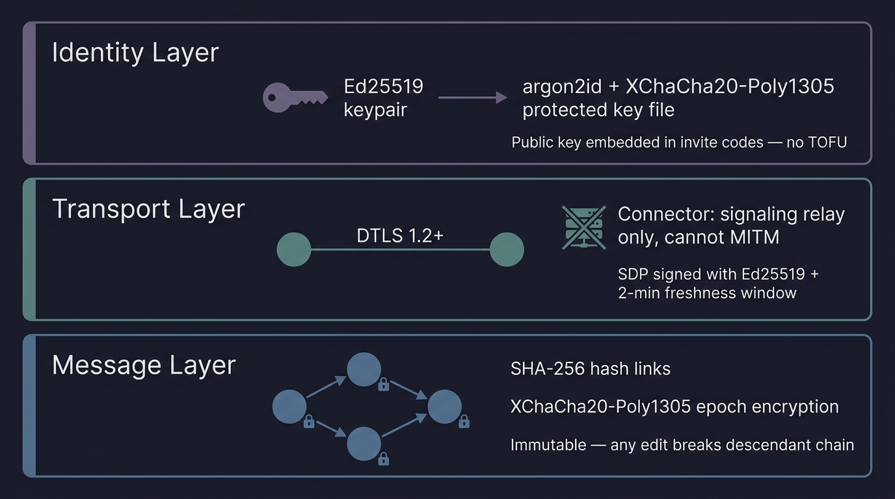
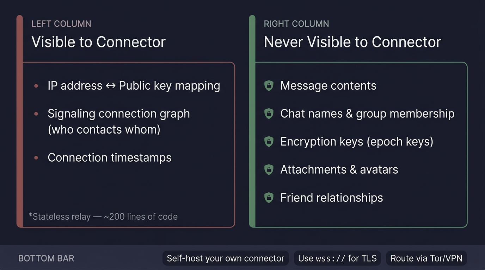
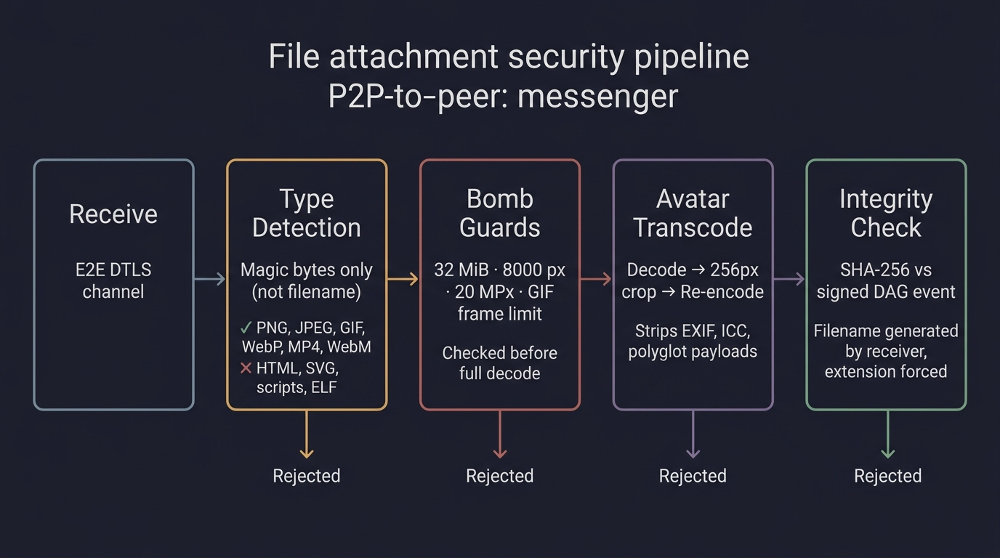

# 🔐 Security Model

> **The only party you need to trust is the person you're talking to.**
> No server ever holds your keys, your messages, or your contact list.

---

## 🔑 Identity

Every user is an **Ed25519 keypair**. That's the entire identity.

- Key file at rest: `SZEPT1` magic + 16-byte salt + `crypt.Seal(argon2id(passphrase, salt, 3 iter, 64 MiB, 2 threads), seed || name)`.
- Stored `0600`. Fingerprint = SHA-256 of pubkey → base32, displayed as `XXXX-XXXX-XXXX-XXXX`.
- Friend and invite codes **embed the full public key** — no TOFU, no trusting the server. MITM at invite time requires tampering with the code outside the app.
- Storage key: `HKDF-SHA256(seed, "szept-storage-v1")` — deterministic, never stored directly.

---

## 🔒 Cryptographic Architecture

### Layer 1: Identity

| Primitive | Usage |
|---|---|
| Ed25519 | Keypair = identity; signs events, SDP offers, registrations |
| argon2id | Passphrase → key derivation (3 iterations, 64 MiB, 2 threads) |
| XChaCha20-Poly1305 | Encrypts key file at rest |
| HKDF-SHA256 | Derives storage key and metadata keys from identity seed |

### Layer 2: Transport (P2P)

- Connections: **WebRTC DTLS 1.2+** via [pion/webrtc](https://github.com/pion/webrtc), NAT traversal via ICE/STUN.
- SDP offers contain the DTLS certificate fingerprint **and a 32-byte ChaCha20 obfuscation key** (`sigPayload.Obf`).
- Every offer is **Ed25519-signed by the sender**, and the receiver verifies:
  1. Signature against sender's known pubkey
  2. `From` matches the connector's `from` stamp
  3. `To` matches our own pubkey (explicit addressee)
  4. Timestamp within ±2 minutes (freshness)
  5. `kind + from + connID` not seen before (replay filter)
- **Glare handling**: simultaneous offers → lower pubkey's offer wins, loser abandons.
- **No TURN relay**. The connector is signaling-only — payload bytes never transit it.
- Result: every data channel is an authenticated, encrypted E2E pipe between two known identities.

### Layer 3: Chat Events (DAG)

Each event in the chat DAG:
- Has its body encrypted with **XChaCha20-Poly1305** under the current **epoch key**, using `signable(chat, kind, author, lamport, epoch, parents)` (with empty Box) as AEAD associated data.
- Is **Ed25519-signed** — signature covers the signable bytes including ciphertext.
- Has its **ID = SHA-256(signable + signature)** — content-addressed and tamper-evident.

History is **immutable** — modifying any event changes its hash and breaks every descendant.

---

## 🧅 Cebulion Network & Connector Security

### Standalone connector

A single connector works as a stateless signaling relay (~200 lines). It maps `pubkey → WebSocket` and forwards opaque blobs. It stamps `from` from the authenticated registration — clients cannot spoof the sender field.

### Cebulion mesh

Connectors can join the **Cebulion Network** — a distributed mesh providing fault tolerance and load balancing:

| Mechanism | Details |
|---|---|
| **SNDP Gossip** | Every 15s, connectors exchange neighbor lists, peer counts, RTT latencies, and full topology via `/ndp/neighbors` (JSON, max 128 KB response). |
| **Topology graph** | BGP-like link-state: `nodeA → nodeB → RTT(ms)`. Max 256 nodes, 64 neighbors. RTT clamped to [1, 100000] ms. |
| **Dijkstra routing** | When `signal`'s destination is not local, `mesh_signal` is forwarded to the optimal next hop (RTT-weighted shortest path). If no route is known, broadcast to all active neighbors. |
| **Loop prevention** | Each `mesh_signal` carries a random 16-char hex `TraceID` and `TTL` (default 5, decremented per hop). Seen traces deduplicated for 5 minutes. |
| **Load shedding** | When `--max-peers` is hit, new clients get a `redirect` message with active neighbor URLs and the connection closes. Client appends these to `FallbackURLs` and retries. |
| **Client failover** | `Client.Run()` reconnects with exponential backoff (1s → 30s, reset after 15s uptime). Tries primary URL, then all `FallbackURLs` in order. On `redirect`, neighbor URLs are appended. |
| **DNS resilience** | On `no such host`: fallback to `1.1.1.1:53`. If port 53 blocked: DNS-over-HTTPS to `https://1.1.1.1/dns-query` (Cloudflare cert has IP SAN, so DNS is not required to query DNS). |

### Registration security

- Registration requires Ed25519 signature over `"szept-register-v1" || pubkey || timestamp(BE64)`.
- Timestamp must be within ±1 minute.
- One socket = one pubkey. Claiming an occupied slot requires a **fresher timestamp** — replaying a captured frame is not enough.
- Per-IP session limit: **64 concurrent WebSockets** per IP address (loopback bypassed for reverse proxy).
- `ReadLimit`: 256 KB per WebSocket message. `ReadHeaderTimeout`: 10s (Slowloris mitigation).

### What the connector sees (honestly)

| Visible | Never visible |
|---|---|
| `pubkey ↔ IP` mapping | Message contents |
| Who signals whom | Chat names & membership |
| Connection timestamps | Epoch keys |
| Mesh topology (RTT between connectors) | Attachments & avatars |
| | Friend relationships |
| | DAG structure or event history |

---

## 💬 Chat Content Security

### Authorization rules

Events are validated **before** persistence (`ingest` → `Fold`):

| Event kind | Authorized author |
|---|---|
| `create` (genesis) | Chat owner (exactly one per chat) |
| `add` | Any current member |
| `remove` / `rekey` | Owner only |
| `msg` / `file` / `react` / `delete` | Any current member |
| `avatar` / `nick` | Any current member (own profile only) |
| `rename` | Any current member |

Validation: signature check → parent presence → `Fold` replays entire DAG with the new event included → authorization failure rejects the event.

### Lamport ordering

DAG ordering comes from the graph, not from sender-supplied values:
- `Lamport` must equal `max(parents) + 1` exactly.
- A parent must be in `seen` (applied) before its child.
- Genesis event: no parents, no Lamport check.

This prevents antedating attacks — e.g. inserting an `add` at Lamport 2 that appears before a `remove` at Lamport 3, or a `Lamport = 2^64-1` that rolls the counter and blocks future events.

### Epoch keys

- Epoch keys travel **only over authenticated E2E channels** (DTLS ctrl channel) to verified members.
- Keys are **never overwritten** in the store: `if _, have := existing[ep]; have { continue }`.
- A key that fails AEAD decryption is treated as absent: content-kind events (`msg`, `file`, `avatar`, `nick`, `react`, `delete`, `rename`) are tolerated without a key; membership events (`create`, `add`, `remove`, `rekey`) require a valid key or the entire fold fails.
- Keys are accepted **only from a current member** or, during join, from the inviter / a friend who introduced the chat.

### Member removal & cascade

Removing a member (`KindRemove`, owner only):
1. `removeTree(st, pub)` — marks the member `Removed = true`.
2. **Cascades** to every member whose `AddedBy` is the removed pubkey — recursively.
3. Triggers epoch rotation (`KindRekey`) — the removed peer can't decrypt new messages.
4. Existing peers refuse sync/want/events from non-members.
5. The removed peer's DTLS link is torn down via `Accept()` returning false.

Without the cascade, an attacker adds a second identity before being kicked — that identity survives and keeps receiving epoch keys.

### Invitations

- Invite code = base64 JSON: `{ chat_id, inviter_pubkey, 128-bit_secret, connector_url, expiry }`.
- PIN = 6 random digits (`crypto/rand`). Inviter stores `SHA-256(secret)` and `SHA-256(pin)`.
- **5-attempt limit** on PIN before the invite is burned (`TakeInvite` atomic). Without this, 10⁶ combinations are brute-forceable in seconds.
- Invite TTL: **10 minutes**. Inviter must be online for redemption.
- Only the **chat owner** can issue invites — preventing members from unilaterally admitting strangers into shared encrypted history.

---

## 📎 Attachments & Avatars

### What enters the DAG

Only metadata: `sha256(content)`, MIME type, filename, size, dimensions, thumbnail hash — inside the signed, encrypted event body. Raw bytes travel separately, in 16 KB chunks, over the same E2E ctrl channel.

### Processing pipeline

| Stage | What happens |
|---|---|
| **Type detection** | Magic bytes (`http.DetectContentType`), never filename. Allowed: PNG, JPEG, GIF, WebP, MP4, WebM. Everything else rejected. |
| **Bomb guards** | Checked before full decode: 32 MiB attachment / 4 MiB avatar input, 8 000 px per side, 20 MPx, GIF frame count limit. |
| **Avatar transcode** | Decode → center-crop 256 px → re-encode PNG (animated GIF preserved). Strips EXIF, ICC profiles, polyglot payloads — only our encoder's bytes reach the DB. |
| **Integrity check** | Receiver computes SHA-256 of received bytes vs. the hash in the signed DAG event. Hash is known only from decrypted history — acts as an access token (without it, you can't even request the file). |
| **Filename** | Generated locally: basename only (no path traversal), control characters stripped, extension **forced by detected MIME**. A network file cannot land as `.sh` or `.exe`. |
| **Transfer control** | Max 3 concurrent blob transfers per peer (`maxServing`). Total assembly memory capped at 64 MiB (`asmBudget`). Send buffer pauses at 1 MiB high water mark. |

Video is never decoded — it's handed to the system player. No decoder attack surface.

Large files (>10 MB) replicate as a preview thumbnail only. The full payload stays at the sender and travels only when the recipient explicitly requests it.

---

## 💾 Data at Rest

The **entire database is encrypted** — not just message bodies. Event envelopes (author pubkey, event kind, epoch, graph links) are encrypted too, because they are conversation metadata. From the database file alone, you cannot even reconstruct a "who talked to whom" graph.

| Data | Key source |
|---|---|
| Event bodies | Chat epoch key (XChaCha20-Poly1305) |
| Event envelopes | Storage key = `HKDF(identity_seed, "szept-storage-v1")` |
| Epoch keys, chat metadata, contacts | HKDF-derived subkeys from identity seed |
| Blobs (attachments, avatars) | Storage key; content-addressed by SHA-256 (same image in 5 chats = 1 copy on disk) |

Only **record keys are plaintext**: event IDs (hashes), blob content-addresses, friend pubkeys — all hashes themselves.

Every value is **bound to its storage location** (bucket + key as AEAD associated data) — you can't rearrange encrypted records, e.g. swap a blob under a different hash or move an epoch key to another chat.

> ⚠️ **A password is optional, but without one there is no encryption at rest.**
> An unprotected `identity.key` can be read by anyone with file access. The storage key derives from its seed — meaning the entire database becomes readable.

Attachments opened via the "Open" button land **decrypted in the system temp directory** and stay there.

---

## 🔒 DPI-Proof Traffic Obfuscation

Every peer-to-peer UDP datagram is wrapped in a ChaCha20 keystream:

| Detail | Value |
|---|---|
| **Key** | 32-byte random, generated by offerer, embedded in Ed25519-signed SDP (`sigPayload.Obf`) |
| **Wire format** | `nonce(12B) \|\| ChaCha20(len(2B) \|\| plaintext \|\| random_padding(0–64B))` |
| **Nonce** | 12-byte random per datagram; safe to ~2⁴⁸ packets/key before birthday risk (session rotates every `Connect()`) |
| **Authentication** | None at this layer (unauthenticated cipher). DTLS underneath authenticates — tampered datagram decrypts to garbage DTLS drops. |
| **STUN bypass** | Public STUN server endpoints (discovered via `ResolveUDPAddr`) are stored in a bypass set and pass through unobfuscated. |
| **mDNS** | Disabled (`MulticastDNSModeDisabled`) — no cleartext `.local` multicast alongside obfuscated flow. |

---

## ⚖️ Known Trade-offs

| Area | Current state | Upgrade path |
|---|---|---|
| **Forward secrecy** | Sessions: yes (ephemeral DTLS). Chat history: no — epoch keys retained so new members can read history. Intentional product decision. | Frequent `/rekey` narrows the window. Double Ratchet for 1:1 chats. |
| **Offline delivery** | None — P2P means no mailbox. | Opt-in sealed-sender store-and-forward relay. |
| **Connector metadata** | Sees connection graph (like a torrent tracker). | Self-host + Tor/VPN + Cebulion mesh. |
| **Mesh calls** | Each participant sees all streams (full mesh). | SFU relay for larger groups. |
| **Traffic analysis** | Packet size/timing can reveal activity. | DTLS-level variable padding (Cebulion already adds 0–64B random pad per datagram). |
| **Orphan flooding** | Capped at 5000 total orphaned events across all chats. | Per-peer rate limiting. |
| **Blob assembly memory** | Capped at 64 MiB total across all concurrent transfers. | Disk-backed assembly for large files. |
